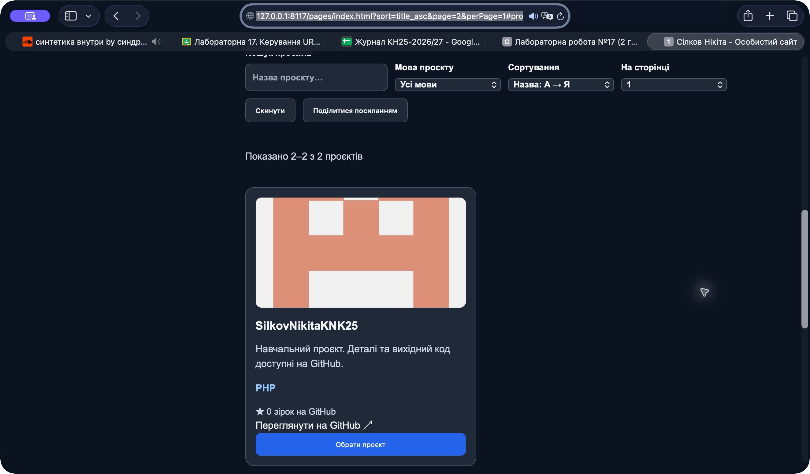
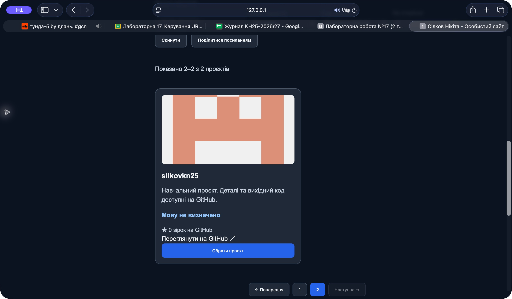
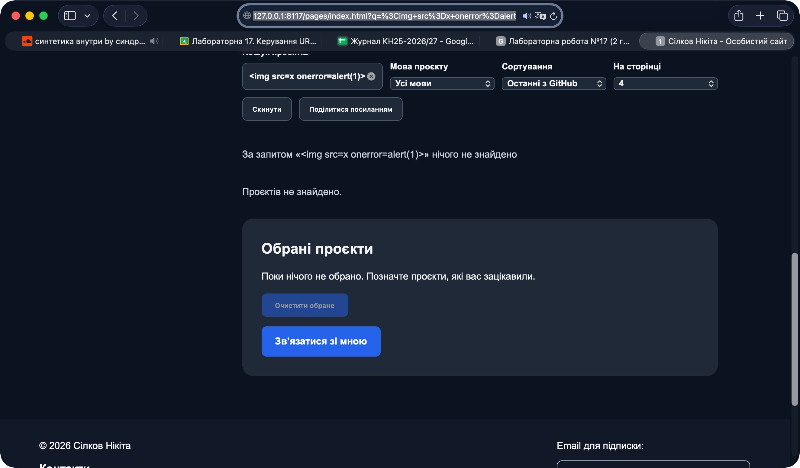
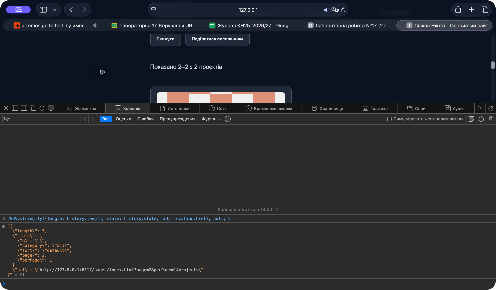

# Лабораторна робота №17

**Студент:** Сілков Нікіта, КН25  
**Дата:** 05.11.2026  
**Тема:** Керування URL-параметрами, історією браузера та пагінація каталогу.

## Результат і адаптація до портфоліо

Продовжено власний сайт із ЛР16: замість товарів TechShop каталог містить реальні публічні GitHub-репозиторії. Фільтр категорій адаптовано до мов програмування. Сортування доступне за назвою в обидва боки, кількістю зірок і часом оновлення. Це дані GitHub, а не вигадані ціни або оцінки покупців. Основні механізми завдання — URLSearchParams, єдиний стан, History API, фільтрація → сортування → slice(), popstate, debounce, скидання й копіювання посилання — реалізовано.

Джерело даних залишено попереднім: GitHub API, до восьми останніх публічних репозиторіїв. На дату перевірки API повертає два проєкти. Для демонстрації другої сторінки додано розміри 1 і 2, поряд з 4/6/8/12 із завдання. За замовчуванням — чотири. Фільтри застосовуються до завантаженого каталогу, а не до всіх можливих репозиторіїв профілю.

Ціновий фільтр і сортування за ціною не додані: у портфоліо немає цін послуг. Додатково реалізовано perPage у URL, навігацію стрілками поза інтерактивними полями та сортування за реальними зірками з їх відображенням на картці. Зірки не є рейтингом покупців.

## Зміни

- `assets/js/catalog-state.js`: чисті функції читання й перевірки стану, побудови URL, сортування та пагінації.
- `assets/js/main.js`: інтеграція стану з API, DOM, історією й подіями. Старий окремий обробник пошуку вилучено.
- `pages/index.html`: підписані фільтри, perPage, скидання, копіювання посилання, інформаційний рядок і пагінація.
- `assets/css/style.css`: адаптивна панель на наявних змінних світлої/темної теми.
- Кореневий `index.html`: перенаправлення зберігає query-параметри та hash.

Зміна мови, сортування чи розміру сторінки повертає на сторінку 1 і використовує pushState. Пошук чекає 300 мс після останнього input та використовує replaceState. Під час popstate відкладений пошук скасовується, стан перечитується з URL. Зайвих записів історії для однакової адреси немає. При старті replaceState записує також початковий history.state. Параметри зі стандартними значеннями вилучаються, сторонні query-параметри та hash зберігаються.

Валідація page приймає лише повний рядок цифр і безпечне додатне ціле: `2abc`, дроби, мінус та надвеликі числа не проходять. Невідома мова замінюється на all, невідоме сортування — default. Номер, що перевищує кількість сторінок, обмежується останньою. При порожньому результаті номер дорівнює 1, пагінація прихована. Повідомлення про пошук використовує textContent, зовнішні поля карток екрануються.

## Запуск

Із кореня репозиторію:

```sh
python3 -m http.server 8117
```

Відкрити `http://127.0.0.1:8117/pages/index.html`. Також працює будь-який звичайний HTTP-сервер або GitHub Pages; file:// не використовувати. Каталог залежить від доступності GitHub API, при помилці залишається повідомлення та кнопка повтору.

Приклади адрес:

- `pages/index.html?sort=title_asc&perPage=1&page=2#projects`
- `pages/index.html?q=Silkov&category=PHP&sort=stars_desc&perPage=2#projects`
- `pages/index.html?sort=hack&page=999&category=cars&perPage=1#projects` — виправляється на дозволені значення.

## Перевірки та скриншоти

Перевірено у Safari й окремому браузерному сеансі: відкриття другої сторінки за URL, відновлення після оновлення, мову PHP, сортування, переходи 1→2 та кнопки Назад/Вперед, живий пошук і успішне копіювання посилання. Вибір проєкту збережено після переходу на іншу сторінку та оновлення. Чернетка форми з тестовим ім’ям і SALE10 відновилася разом із розрахунком знижки. Додаткові автоматичні перевірки чистих функцій охопили дробові/частково числові/надвеликі page, дублікати параметрів, кодування C++ та &, незмінність вихідного масиву, останню й порожню сторінки. JS пройшов перевірку синтаксису.

### Сторінка 2 та параметри URL



### Некоректні параметри

Вхід: `?sort=hack&page=999&category=cars&perPage=1`. Результат: sort=default і category=all вилучено з URL, page обмежено до 2 — останньої сторінки поточного каталогу.



### XSS-рядок

`` показується звичайним текстом, alert не відкривається.



### History API у справжній консолі Safari

У консолі виконано `JSON.stringify({length: history.length, state: history.state, url: location.href}, null, 2)`. На скриншоті length=5, state містить page=2, perPage=1 та стандартні q/category/sort. Length рахує всю історію поточної вкладки, включно з навігаціями до перевірки; це не кількість сторінок каталогу. pushState додає запис, replaceState змінює поточний без збільшення length.



## Основні фрагменти коду

### readStateFromURL()

Повертає перевірений стан. Категорія остаточно перевіряється після завантаження даних.

```js
export function readStateFromURL(search) {
    const p = new URLSearchParams(search);
    const integer = (value, fallback) => /^\d+$/.test(value ?? '') && Number.isSafeInteger(Number(value)) && Number(value) > 0 ? Number(value) : fallback;
    const perPage = integer(p.get('perPage'), 4);
    return {
        q: (p.get('q') || '').trim().slice(0, 50),
        category: (p.get('category') || 'all').slice(0, 100),
        sort: ALLOWED_SORTS.includes(p.get('sort')) ? p.get('sort') : 'default',
        page: integer(p.get('page'), 1),
        perPage: ALLOWED_PAGE_SIZES.includes(perPage) ? perPage : 4
    };
}
```

### syncURL()

Використовує stateURL із URLSearchParams; передає копію стану та обирає push/replace.

```js
function syncURL(mode) {
    const url = stateURL(location.href, catalogState);
    // replace також створює початковий знімок history.state, push — лише реальні зміни.
    if (mode === 'replace' || url.href !== location.href) history[mode === 'push' ? 'pushState' : 'replaceState']({...catalogState}, '', url);
}
```

### paginateProducts()

Обчислює межі та повертає тільки поточну сторінку без зміни каталогу.

```js
export function paginateProducts(projects, page, perPage) {
    const totalPages = Math.max(1, Math.ceil(projects.length / perPage));
    const currentPage = Math.max(1, Math.min(page, totalPages));
    const startIndex = (currentPage-1)*perPage;
    return {items: projects.slice(startIndex, startIndex+perPage), totalItems: projects.length, totalPages, currentPage, startIndex};
}
```

### popstate

Скасовує таймер пошуку й відновлює контролі з поточного URL без pushState.

```js
window.addEventListener('popstate', () => {
    clearTimeout(searchTimer); catalogState=readStateFromURL(location.search);
    applyStateToControls(); updateCatalog(); // не додає записів в історію
});
```

## Відповіді на контрольні запитання

1. **URL чи localStorage?** Фільтри описують конкретну вибірку, тому URL дозволяє передати її іншій людині, відкрити у чистому сеансі та відновити після F5. Обране й тема — локальні вподобання користувача, які не повинні змінюватися через надіслану адресу. Чернетка контактів зберігається лише в sessionStorage поточної вкладки.
2. **get, set, append, delete.** get повертає перше значення ключа або null; set встановлює одне значення й прибирає дублікати; append додає ще одну пару з цим ключем; delete вилучає його значення. URLSearchParams коректно кодує пробіли, кирилицю, + та &, що зменшує ризик помилок ручного склеювання.
3. **location.search і pushState.** Присвоєння location.search є навігацією та завантажує документ. pushState змінює запис історії й адресу в межах того самого origin без мережевого завантаження документа; інтерфейс має оновити наш код.
4. **Вибір push/replace.** Категорія, сортування та сторінка — окремі завершені дії, до яких зручно повернутися. Пошук змінюється на кожну літеру: replace не створює десятки записів. Він замінює поточну вибірку, тому сам по собі не гарантує повернення до стану перед першою літерою; Назад відкриває попередній наявний запис історії.
5. **popstate.** Виникає при переході між записами сесійної історії, наприклад Назад/Вперед. pushState додає запис, але не виконує такий перехід і не генерує popstate. Якщо в обробнику додавати новий запис, можна зламати Вперед та отримати цикл навігації.
6. **Чому slice останній?** Сторінка — частина всієї вже відібраної й упорядкованої множини. Якщо нарізати раніше, фільтр шукатиме тільки серед кількох початкових записів, а сортування не врахує решту каталогу.
7. **Формули.** startIndex=(page−1)×perPage; endIndex=startIndex+perPage; totalPages=Math.max(1,Math.ceil(totalItems/perPage)). slice не включає endIndex; якщо він завеликий, повертаються всі доступні елементи від startIndex до кінця без помилки. Для порожнього списку повертається [].
8. **Копія перед sort.** sort змінює вихідний масив. [...projects] дає новий масив посилань, тому порядок завантаженого каталогу зберігається для стандартного режиму й інших операцій.
9. **Загрози та захист.** Некоректний URL може спричинити помилковий номер сторінки, невалідне сортування або XSS при небезпечній вставці HTML. Використано allowlist, обмеження довжини q, повну перевірку числа через регулярний вираз і Number.isSafeInteger, перевірку категорій за даними API, textContent та екранування. Це також відхиляє `2abc`, який звичайний parseInt прочитав би як 2.
10. **Скидання на сторінку 1.** Нова вибірка може мати менше сторінок. Залишивши старий номер, можна отримати порожній або несподіваний результат. Після зміни критеріїв починаємо з першої сторінки; URL із завеликим page нормалізується окремо.
11. **Debounce.** Кожен input скасовує попередній таймер і ставить новий на 300 мс. Оновлення виконується після паузи, зменшуючи кількість фільтрацій і рендерів. Перехід по історії та скидання скасовують таймер, щоб запізнілий пошук не перезаписав відновлений стан.

## Висновок

Каталог отримав відтворювані URL, пагінацію й навігацію історією без перезавантаження. Особисті дані форми не потрапляють до URL; обране працює незалежно від поточної сторінки.

[Умова лабораторної](https://surkovkostiantyn.github.io/nmk/web_technology/lab_17_new.html)
