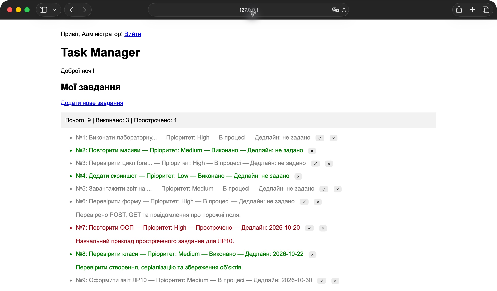
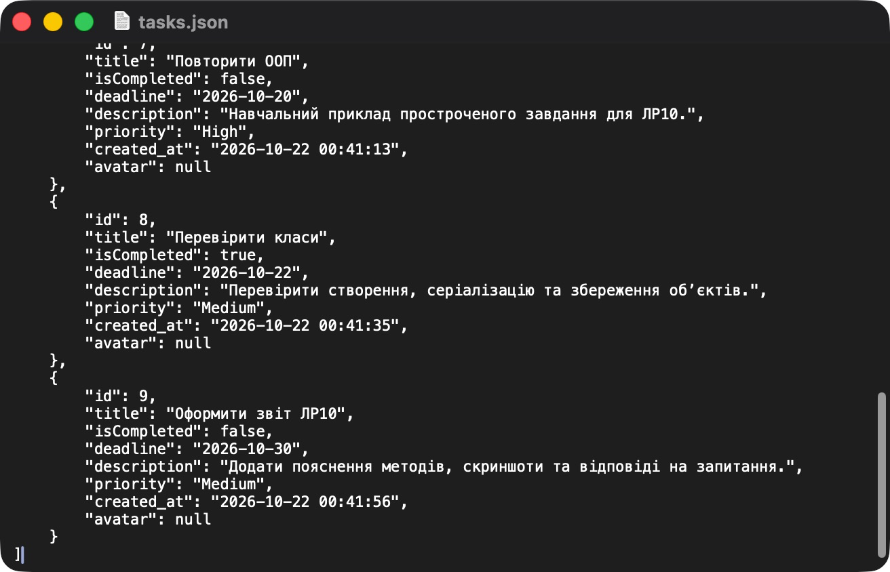

# Лабораторна робота №10

**Студент:** Сілков Нікіта  
**Тема:** Вступ до ООП у PHP. Рефакторинг проєкту «Менеджер завдань».  
**Дата перевірки:** 22.10.2026

## Мета

Навчитися використовувати класи, об’єкти, конструктор, модифікатори доступу та статичні методи. Перенести роботу із завданнями в класи Task і TaskRepository та зберігати об’єкти у JSON.

## Основа та виконані зміни

За основу взято власну лабораторну №9 з папки `phpsilkov25`. Збережено вхід і вихід через сесії, привітання, скорочення довгих назв, опис, пріоритет, завантаження зображень та навчальні режими GET/POST.

Шість попередніх записів перенесено з `data.json` до `tasks.json` зі збереженням ID, назв, статусів та інших наявних полів. `data.json` залишено як знімок попередньої роботи; поточний застосунок використовує тільки `tasks.json`. Ключ `is_completed` перетворено на `isCompleted`, а старі записи отримали `deadline: null`.

За умовою ЛР10 головна сторінка тепер також перевіряє авторизацію і перенаправляє гостя на `login.php`. Створення залишено в `create.php`, але запис виконується через `$repo->add()`. На `index.php` додано POST-кнопки виконання й видалення, три статуси та статистику; шаблон отримує значення через методи Task.

## Клас Task — повний код

```php
<?php
declare(strict_types=1);

class Task
{
    public function __construct(
        public readonly int $id,
        private string $title,
        private bool $isCompleted = false,
        private ?string $deadline = null,
        private string $description = '',
        private string $priority = 'Medium',
        private ?string $createdAt = null,
        private ?string $avatar = null,
    ) {
        $this->title = trim($title);
        if ($this->title === '') {
            throw new InvalidArgumentException('Назва завдання не може бути порожньою.');
        }
        if ($deadline !== null) {
            $date = DateTimeImmutable::createFromFormat('!Y-m-d', $deadline);
            if (!$date || $date->format('Y-m-d') !== $deadline) {
                throw new InvalidArgumentException('Вкажіть коректну дату дедлайну.');
            }
        }
        if (!in_array($priority, ['Low', 'Medium', 'High'], true)) {
            throw new InvalidArgumentException('Некоректний пріоритет.');
        }
    }

    public function getId(): int { return $this->id; }
    public function getTitle(): string { return $this->title; }
    public function isCompleted(): bool { return $this->isCompleted; }
    public function getDeadline(): ?string { return $this->deadline; }
    public function getDescription(): string { return $this->description; }
    public function getPriority(): string { return $this->priority; }
    public function getCreatedAt(): ?string { return $this->createdAt; }
    public function getAvatar(): ?string { return $this->avatar; }

    public function isOverdue(): bool
    {
        // Поле date задає день: завдання прострочене після завершення цього дня.
        return !$this->isCompleted && $this->deadline !== null
            && $this->deadline < date('Y-m-d');
    }

    public function complete(): void
    {
        $this->isCompleted = true;
    }

    public function getStatusLabel(): string
    {
        if ($this->isCompleted) return 'Виконано';
        if ($this->isOverdue()) return 'Прострочено';
        return 'В процесі';
    }

    public function toArray(): array
    {
        return [
            'id' => $this->id,
            'title' => $this->title,
            'isCompleted' => $this->isCompleted,
            'deadline' => $this->deadline,
            'description' => $this->description,
            'priority' => $this->priority,
            'created_at' => $this->createdAt,
            'avatar' => $this->avatar,
        ];
    }

    public static function fromArray(array $data): self
    {
        return new self(
            id: $data['id'],
            title: $data['title'],
            isCompleted: $data['isCompleted'] ?? $data['is_completed'] ?? false,
            deadline: $data['deadline'] ?? null,
            description: $data['description'] ?? '',
            priority: $data['priority'] ?? 'Medium',
            createdAt: $data['created_at'] ?? null,
            avatar: $data['avatar'] ?? null,
        );
    }
}
```

### Пояснення методів Task

| Метод | Пояснення |
|---|---|
| `__construct()` | Ініціалізує типізовані властивості через Constructor Property Promotion. Перевіряє непорожню назву, дату дедлайну та допустимий пріоритет. |
| `getId()` | Повертає незмінний ідентифікатор завдання. |
| `getTitle()` | Повертає назву, приховану у private-властивості. |
| `isCompleted()` | Повертає поточну ознаку виконання. |
| `getDeadline()` | Повертає дату дедлайну або null, якщо його не задано. |
| `getDescription()` | Повертає опис, збережений із попередніх лабораторних. |
| `getPriority()` | Повертає пріоритет Low, Medium або High. |
| `getCreatedAt()` | Повертає час створення або null для старих записів без цього поля. |
| `getAvatar()` | Повертає шлях до завантаженого зображення або null. |
| `isOverdue()` | Перевіряє, чи невиконане завдання має дедлайн раніше поточної дати. Оскільки форма містить дату без часу, сьогоднішній дедлайн діє до кінця дня. |
| `complete()` | Позначає завдання виконаним, змінюючи private-властивість isCompleted. |
| `getStatusLabel()` | Повертає «Виконано», «Прострочено» або «В процесі». Виконане завдання не вважається простроченим. |
| `toArray()` | Перетворює всі поля об’єкта на асоціативний масив для JSON-кодування. |
| `fromArray()` | Статично створює об’єкт із масиву. Підтримує старий ключ is_completed, щоб не втратити статуси з ЛР9. |

## Клас TaskRepository — повний код

```php
<?php
declare(strict_types=1);
require_once __DIR__ . '/Task.php';

class TaskRepository
{
    /** @var Task[] */
    private array $tasks = [];

    public function __construct(private string $storageFile)
    {
        $this->load();
    }

    /** @return Task[] */
    public function findAll(): array { return $this->tasks; }

    public function findById(int $id): ?Task
    {
        foreach ($this->tasks as $task) {
            if ($task->getId() === $id) return $task;
        }
        return null;
    }

    public function add(string $title, ?string $deadline = null,
        string $description = '', string $priority = 'Medium', ?string $avatar = null): Task
    {
        return $this->update(function () use ($title, $deadline, $description, $priority, $avatar): Task {
            $task = new Task($this->generateNextId(), $title, false, $deadline,
                $description, $priority, date('Y-m-d H:i:s'), $avatar);
            $this->tasks[] = $task;
            return $task;
        });
    }

    public function complete(int $id): bool
    {
        return $this->update(function () use ($id): bool {
            $task = $this->findById($id);
            if ($task === null) return false;
            $task->complete();
            return true;
        });
    }

    public function delete(int $id): bool
    {
        return $this->update(function () use ($id): bool {
            foreach ($this->tasks as $key => $task) {
                if ($task->getId() === $id) {
                    unset($this->tasks[$key]);
                    $this->tasks = array_values($this->tasks);
                    return true;
                }
            }
            return false;
        });
    }

    public function countCompleted(): int
    {
        return count(array_filter($this->tasks, fn(Task $task) => $task->isCompleted()));
    }

    public function countOverdue(): int
    {
        return count(array_filter($this->tasks, fn(Task $task) => $task->isOverdue()));
    }

    private function generateNextId(): int
    {
        return empty($this->tasks) ? 1
            : max(array_map(fn(Task $task) => $task->getId(), $this->tasks)) + 1;
    }

    private function load(): void
    {
        if (!file_exists($this->storageFile)) return;
        $file = fopen($this->storageFile, 'r');
        if ($file === false) throw new RuntimeException('Не вдалося відкрити файл завдань.');
        try {
            if (!flock($file, LOCK_SH)) throw new RuntimeException('Не вдалося заблокувати файл.');
            $this->decode(stream_get_contents($file));
        } finally {
            flock($file, LOCK_UN);
            fclose($file);
        }
    }

    private function decode(string $json): void
    {
        $data = json_decode($json, true, 512, JSON_THROW_ON_ERROR);
        if (!is_array($data) || !array_is_list($data)) {
            throw new RuntimeException('Файл завдань має містити JSON-масив.');
        }
        $this->tasks = array_map(fn(array $item) => Task::fromArray($item), $data);
    }

    // Читання, зміна та запис виконуються під одним блокуванням.
    private function update(callable $change): mixed
    {
        $file = fopen($this->storageFile, 'c+');
        if ($file === false) throw new RuntimeException('Не вдалося відкрити файл для запису.');
        try {
            if (!flock($file, LOCK_EX)) throw new RuntimeException('Не вдалося заблокувати файл.');
            $json = stream_get_contents($file);
            if ($json === '') $this->tasks = [];
            else $this->decode($json);
            $result = $change();
            $this->save($file);
            return $result;
        } finally {
            flock($file, LOCK_UN);
            fclose($file);
        }
    }

    private function save($file): void
    {
        $data = array_map(fn(Task $task) => $task->toArray(), $this->tasks);
        $json = json_encode($data, JSON_PRETTY_PRINT | JSON_UNESCAPED_UNICODE | JSON_THROW_ON_ERROR);
        rewind($file);
        if (fwrite($file, $json) !== strlen($json) || !ftruncate($file, strlen($json)) || !fflush($file)) {
            throw new RuntimeException('Не вдалося зберегти завдання.');
        }
    }
}
```

### Пояснення методів TaskRepository

| Метод | Пояснення |
|---|---|
| `__construct()` | Приймає шлях до JSON-файлу та викликає load() для завантаження колекції. |
| `findAll()` | Повертає масив об’єктів Task для відображення списку. |
| `findById()` | Шукає завдання за ID. Повертає об’єкт або null, якщо такого запису немає. |
| `add()` | Створює Task із новим ID, додає його до колекції та зберігає зміни через update(). Також приймає опис, пріоритет і шлях зображення з попередньої форми. |
| `complete()` | Знаходить завдання та викликає його complete(), після чого записує колекцію. Повертає false, якщо ID не знайдено. |
| `delete()` | Видаляє об’єкт із колекції та відновлює послідовні індекси масиву. Це зберігає JSON у вигляді списку, а не об’єкта. |
| `countCompleted()` | Рахує виконані завдання через array_filter() та isCompleted(). |
| `countOverdue()` | Рахує прострочені завдання через array_filter() та isOverdue(). |
| `generateNextId()` | Повертає найбільший поточний ID плюс один. Для порожньої колекції повертає 1. |
| `load()` | Читає сховище під спільним блокуванням і передає JSON у decode(). Відсутній файл означає порожню колекцію; файл створюється при першому записі. |
| `decode()` | Перевіряє JSON та структуру списку, після чого відновлює об’єкти через Task::fromArray(). Пошкоджений JSON спричиняє виняток, а не мовчазну втрату даних. |
| `update()` | Блокує файл на весь цикл читання, зміни й запису та перечитує актуальні дані перед операцією. Блок finally звільняє блокування і закриває файл навіть при помилці. |
| `save()` | Перетворює об’єкти через toArray(), кодує JSON та записує його у вже заблокований файл. Перевіряє запис, обрізання старого вмісту та скидання буфера. |

## Запуск

Потрібен PHP 8.1 або новіший із mbstring та fileinfo. Перевірено на PHP 8.2.4 із XAMPP.

Із кореня репозиторію:

```sh
/Applications/XAMPP/xamppfiles/bin/php -S 127.0.0.1:8094 -t phpsilkov25
```

Відкрити `http://127.0.0.1:8094/index.php`, увійти як **admin / 12345**. Якщо `php` є у PATH, достатньо команди `php -S 127.0.0.1:8094 -t phpsilkov25`. Файл `tasks.json` та каталог `uploads` мають бути доступні для запису. На скриншотах використано окремий тестовий порт 8100. GitHub Pages не виконує PHP.

## Перевірка роботи

1. Перехід гостя на `index.php` і прямий POST до `create.php` перенаправляють на вхід. Неправильний пароль показує помилку; правильний відкриває головну.
2. Через форму додано три нові завдання: №7 із дедлайном 20.10.2026, №8 із дедлайном 22.10.2026 та №9 із дедлайном 30.10.2026.
3. Завдання №8 позначено виконаним кнопкою ✓. На дату перевірки №7 має статус «Прострочено», №8 — «Виконано», №9 — «В процесі».
4. Додатковий тимчасовий запис видалено через POST-обробник кнопки ✕. У JSON збереглися тільки шість старих і три нові демонстраційні завдання.
5. Після перезавантаження сторінки дані та статуси збереглися. Підсумок: **9 завдань, 3 виконано, 1 прострочено**.
6. Перевірено порожню назву, неіснуючу дату, завдання без дедлайну, екранування HTML і відсутність запису в демонстраційних GET/POST-режимах.
7. Перевірено завантаження справжнього JPEG: файл збережено, шлях записано через репозиторій. Тимчасове завдання та тестове зображення після перевірки прибрано.
8. Окремо перевірено серіалізацію, підтримку старого формату, пошук відсутнього ID, статистику, захист від перезапису пошкодженого JSON та послідовні зміни двома екземплярами репозиторію.
9. Вихід завершує сесію; сторінка створення знову недоступна гостю. Усі змінені PHP-файли пройшли перевірку синтаксису `php -l`.

### Сторінка зі статусами



### Файл tasks.json у текстовому редакторі

У кінці файлу показано три завдання, додані під час перевірки ЛР10. Попередні шість записів також збережено у цьому файлі.



## Відповіді на контрольні запитання

1. **Що таке клас і чим він відрізняється від масиву?** Клас описує властивості та поведінку об’єктів одного типу. Масив лише зберігає значення за ключами, а Task також перевіряє дані й містить методи завершення та визначення статусу. Так логіка завдання зосереджена в одному місці.
2. **Навіщо private для title?** Це обмежує прямий доступ до властивості з іншого коду. Прочитати назву можна через публічний `getTitle()`, а неконтрольоване присвоєння `$task->title = ...` заборонене.
3. **Що означає public readonly int $id у конструкторі?** Constructor Property Promotion одночасно оголошує властивість, параметр і присвоює початкове значення. `int` задає тип, `public` дозволяє читання ззовні, `readonly` забороняє зміну після ініціалізації. ID має залишатися сталим, тоді як isCompleted змінюється при виконанні завдання.
4. **Що робить Task::fromArray($data) і навіщо static?** Метод отримує масив і створює новий Task із відповідними полями. Він є static, бо ще немає об’єкта, на якому його можна було б викликати; фабричний метод викликається на самому класі.
5. **Як add() приводить до запису в tasks.json?** `add()` викликає `update()`, який відкриває і блокує файл та перечитує актуальну колекцію. Далі генерується ID, створюється Task і додається до списку. `save()` викликає `toArray()` для об’єктів, перетворює масиви через `json_encode()` та записує JSON. Наприкінці файл закривається й блокування звільняється.

## Висновок

Менеджер завдань переведено на об’єктно-орієнтований підхід. Task відповідає за дані та поведінку окремого завдання, а TaskRepository — за колекцію й збереження; можливості попередньої роботи інтегровано з новим сховищем.

## Посилання

- [Умова лабораторної №10](https://surkovkostiantyn.github.io/nmk/programming/lab_10.html)
- [Приклад викладача](https://github.com/SurkovKostiantyn/kn25ipz25/tree/main/php_lab_10)
- [Попередній звіт №9](lab9.md)
- [Код проєкту](https://github.com/nikitauroboros-cpu/SilkovNikitaKNK25/tree/main/phpsilkov25)
- [Коміт реалізації ЛР10](https://github.com/nikitauroboros-cpu/SilkovNikitaKNK25/commit/289fb0127a58ea45d1283583ce4756ed9d104072)
