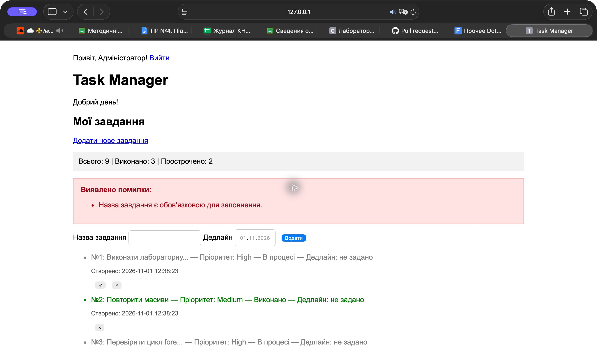
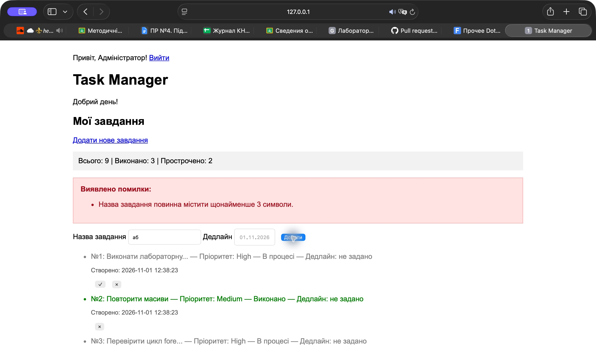
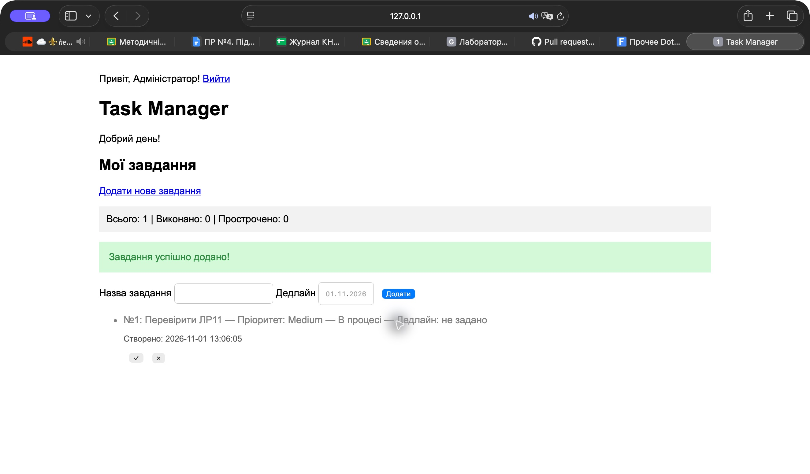
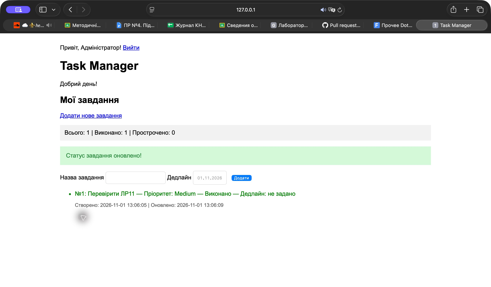

# Лабораторна робота №11

**Студент:** Сілков Нікіта  
**Група:** КН25  
**Дата:** 01.11.2026  
**Тема:** Застосування інтерфейсів, трейтів та обробки винятків у PHP.

## Мета та виконані зміни

Доопрацьовано «Менеджер завдань» із ЛР10. Додано контракт TaskStorageInterface, трейт TimestampableTrait та ієрархію TaskManagerException → ValidationException / TaskNotFoundException. TaskRepository реалізує контракт; некоректні дані та відсутні ID спричиняють типізовані винятки. Контролер показує повідомлення без аварійного завершення, повертає HTTP 422 або 404 та використовує try/catch/finally. Після успішного POST виконується перенаправлення 303.

Збережено авторизацію, опис, пріоритет, зображення й читання старих полів created_at / is_completed. Під час збереження використовуються createdAt та updatedAt. Для старих записів без дати початковий час встановлюється під час відновлення об’єкта; це не історична дата їх створення. Блокування JSON-файлу охоплює читання, зміну і запис; finally звільняє файл навіть при винятку.

## Запуск

Потрібен PHP 8.1+ із mbstring та fileinfo. Перевірено на PHP 8.2.4 із XAMPP.

```sh
php -S 127.0.0.1:8111 -t phpsilkov25
```

Відкрити http://127.0.0.1:8111/index.php. Навчальний вхід: admin / 12345. tasks.json та uploads мають бути доступні для запису. GitHub Pages не виконує PHP.

## Перевірка

Автоматично перевірено контракт, порожні та короткі українські назви, одночасне повернення кількох помилок, невалідну дату, створення та збереження обох часових міток, попередні поля, стару схему JSON, видалення, відсутній ID і захист пошкодженого JSON від перезапису. Через HTTP перевірено авторизацію, 422 для некоректних даних, 404 для відсутнього ID, додавання, виконання, видалення та некоректний формат полів. Усі перевірки пройшли.

Скриншоти зроблено у Safari на окремій тестовій копії. Основне сховище попередніх робіт не змінювалося.

### Порожня назва



### Назва з двох символів



### Створення завдання



### Виконання завдання



## Фрагмент tasks.json після виконання

```json
[
    {
        "id": 1,
        "title": "Перевірити ЛР11",
        "isCompleted": true,
        "deadline": null,
        "description": "",
        "priority": "Medium",
        "createdAt": "2026-11-01 13:06:05",
        "updatedAt": "2026-11-01 13:06:09",
        "avatar": null
    }
]
```

Після complete() поле updatedAt змінилося, createdAt залишилося тим самим. Значення отримані з тестового сховища, а не сформовані вручну.

## Відповіді на контрольні запитання

1. **Інтерфейс і абстрактний клас.** Інтерфейс задає публічний контракт методів, які зобов’язана реалізувати конкретна реалізація. Абстрактний клас може також зберігати стан, містити реалізовані методи й конструктор; безпосередньо створити його об’єкт не можна. Клас може реалізувати кілька інтерфейсів, але успадковує лише один клас. Для сховища потрібна спільна поведінка доступу до завдань без нав’язування внутрішньої реалізації, тому обрано інтерфейс.

2. **Слабкий зв’язок і перехід на PDO.** Код, що використовує лише методи TaskStorageInterface, може працювати і з JSON, і з майбутнім PdoTaskRepository. Новий клас реалізує ті самі сигнатури, повертає Task і генерує ті самі доменні винятки. У точці створення залежності JSON-репозиторій замінюється на PDO-реалізацію; виведення списку й базові дії не потребують змін. Додаткові параметри опису, пріоритету та зображення у create.php є розширенням поточної реалізації: для повної взаємозамінності розширеної форми їх треба також узгодити в контракті або окремому об’єкті даних.

3. **Призначення трейта.** TimestampableTrait повторно надає поля createdAt/updatedAt і методи initTimestamps(), touch() та геттери різним класам. Це дозволяє додати аудит часу без спільного базового класу й дублювання коду. Трейт не створює самостійних об’єктів і не замінює контракт інтерфейсу; його методи включаються в клас через use.

4. **Порядок catch.** PHP обирає перший сумісний блок. ValidationException успадковує TaskManagerException, а той належить до Throwable. Якщо загальний catch стоїть першим, він перехопить і спеціалізований виняток, а список getErrors() не буде оброблено належним способом. Тому спочатку ловимо ValidationException та TaskNotFoundException, потім TaskManagerException і наприкінці Throwable для інших помилок.

5. **Коли виконується finally.** За звичайного виконання finally запускається після try і відповідного catch незалежно від того, чи виник виняток; також він виконується перед завершенням через return або поширенням неперехопленого винятку. У ньому доцільно закривати дескриптори й звільняти блокування файлів. У репозиторії це flock(LOCK_UN) і fclose(). У контролері finally встановлює ознаку завершення POST, а redirect/exit винесено після нього. Не слід покладатися на finally при exit усередині try, примусовому завершенні процесу або аварії середовища.

## Код створених та оновлених файлів

Нижче наведено повні актуальні версії, включно зі змінами для сумісності з попередніми роботами.

### TaskStorageInterface.php

```php
<?php
declare(strict_types=1);

require_once __DIR__ . '/Task.php';

interface TaskStorageInterface
{
    /**
     * Повертає список усіх наявних завдань.
     *
     * @return Task[]
     */
    public function findAll(): array;

    /**
     * Знаходить завдання за його ідентифікатором.
     */
    public function findById(int $id): ?Task;

    /**
     * Додає нове завдання до сховища.
     *
     * @throws ValidationException якщо назва або дедлайн не проходять валідацію
     */
    public function add(string $title, ?string $deadline = null): Task;

    /**
     * Позначає завдання як виконане.
     *
     * @throws TaskNotFoundException якщо завдання з таким id не існує
     */
    public function complete(int $id): bool;

    /**
     * Видаляє завдання зі сховища.
     *
     * @throws TaskNotFoundException якщо завдання з таким id не існує
     */
    public function delete(int $id): bool;

    /**
     * Повертає кількість виконаних завдань.
     */
    public function countCompleted(): int;

    /**
     * Повертає кількість прострочених завдань.
     */
    public function countOverdue(): int;
}
```

### TimestampableTrait.php

```php
<?php
declare(strict_types=1);

trait TimestampableTrait
{
    private string $createdAt;
    private ?string $updatedAt = null;

    /**
     * Ініціалізує початкові значення дат створення та оновлення.
     */
    public function initTimestamps(?string $createdAt = null, ?string $updatedAt = null): void
    {
        $this->createdAt = $createdAt ?? date('Y-m-d H:i:s');
        $this->updatedAt = $updatedAt;
    }

    /**
     * Оновлює мітку часу останньої модифікації на поточний момент.
     */
    public function touch(): void
    {
        $this->updatedAt = date('Y-m-d H:i:s');
    }

    public function getCreatedAt(): string
    {
        return $this->createdAt;
    }

    public function getUpdatedAt(): ?string
    {
        return $this->updatedAt;
    }
}
```

### Exceptions.php

```php
<?php
declare(strict_types=1);

/**
 * Базовий клас для всіх доменних помилок у системі управління завданнями.
 */
class TaskManagerException extends RuntimeException {}

/**
 * Виняток, що виникає при зверненні до завдання за неіснуючим ID.
 */
class TaskNotFoundException extends TaskManagerException
{
    public function __construct(int $taskId)
    {
        parent::__construct("Завдання з ідентифікатором #{$taskId} не знайдено.", 404);
    }
}

/**
 * Виняток валідації вхідних даних (може містити перелік із кількох помилок).
 */
class ValidationException extends TaskManagerException
{
    /** @var string[] */
    private array $errors;

    public function __construct(array $errors)
    {
        $this->errors = $errors;
        parent::__construct('Помилка валідації даних форми: ' . implode(', ', $errors), 422);
    }

    /**
     * Повертає масив текстових повідомлень про помилки.
     *
     * @return string[]
     */
    public function getErrors(): array
    {
        return $this->errors;
    }
}
```

### Task.php

```php
<?php
declare(strict_types=1);

require_once __DIR__ . '/TimestampableTrait.php';
require_once __DIR__ . '/Exceptions.php';

class Task
{
    use TimestampableTrait;
    public function __construct(
        public readonly int $id,
        private string $title,
        private bool $isCompleted = false,
        private ?string $deadline = null,
        private string $description = '',
        private string $priority = 'Medium',
        ?string $createdAt = null,
        private ?string $avatar = null,
        ?string $updatedAt = null,
    ) {
        $this->initTimestamps($createdAt, $updatedAt);
        $this->title = trim($title);
        $errors = [];
        if ($this->title === '') {
            $errors[] = 'Назва завдання є обов’язковою для заповнення.';
        } elseif (mb_strlen($this->title, 'UTF-8') < 3) {
            $errors[] = 'Назва завдання повинна містити щонайменше 3 символи.';
        }
        if ($deadline === '') $this->deadline = null;
        if ($this->deadline !== null) {
            $date = DateTimeImmutable::createFromFormat('!Y-m-d', $this->deadline);
            if (!$date || $date->format('Y-m-d') !== $this->deadline) {
                $errors[] = 'Вкажіть коректну дату дедлайну.';
            }
        }
        if (!in_array($priority, ['Low', 'Medium', 'High'], true)) {
            $errors[] = 'Некоректний пріоритет.';
        }
        if ($errors !== []) throw new ValidationException($errors);
    }

    public function getId(): int { return $this->id; }
    public function getTitle(): string { return $this->title; }
    public function isCompleted(): bool { return $this->isCompleted; }
    public function getDeadline(): ?string { return $this->deadline; }
    public function getDescription(): string { return $this->description; }
    public function getPriority(): string { return $this->priority; }
    public function getAvatar(): ?string { return $this->avatar; }

    public function isOverdue(): bool
    {
        // Поле date задає день: завдання прострочене після завершення цього дня.
        return !$this->isCompleted && $this->deadline !== null
            && $this->deadline < date('Y-m-d');
    }

    public function complete(): void
    {
        $this->isCompleted = true;
        $this->touch();
    }

    public function getStatusLabel(): string
    {
        if ($this->isCompleted) return 'Виконано';
        if ($this->isOverdue()) return 'Прострочено';
        return 'В процесі';
    }

    public function toArray(): array
    {
        return [
            'id' => $this->id,
            'title' => $this->title,
            'isCompleted' => $this->isCompleted,
            'deadline' => $this->deadline,
            'description' => $this->description,
            'priority' => $this->priority,
            'createdAt' => $this->getCreatedAt(),
            'updatedAt' => $this->getUpdatedAt(),
            'avatar' => $this->avatar,
        ];
    }

    public static function fromArray(array $data): self
    {
        return new self(
            id: $data['id'],
            title: $data['title'],
            isCompleted: $data['isCompleted'] ?? $data['is_completed'] ?? false,
            deadline: $data['deadline'] ?? null,
            description: $data['description'] ?? '',
            priority: $data['priority'] ?? 'Medium',
            createdAt: $data['createdAt'] ?? $data['created_at'] ?? null,
            updatedAt: $data['updatedAt'] ?? null,
            avatar: $data['avatar'] ?? null,
        );
    }
}
```

### TaskRepository.php

```php
<?php
declare(strict_types=1);
require_once __DIR__ . '/Task.php';

require_once __DIR__ . '/TaskStorageInterface.php';
require_once __DIR__ . '/Exceptions.php';

class TaskRepository implements TaskStorageInterface
{
    /** @var Task[] */
    private array $tasks = [];

    public function __construct(private string $storageFile)
    {
        $this->load();
    }

    /** @return Task[] */
    public function findAll(): array { return $this->tasks; }

    public function findById(int $id): ?Task
    {
        foreach ($this->tasks as $task) {
            if ($task->getId() === $id) return $task;
        }
        return null;
    }

    /** @throws ValidationException */
    public function add(string $title, ?string $deadline = null,
        string $description = '', string $priority = 'Medium', ?string $avatar = null): Task
    {
        return $this->update(function () use ($title, $deadline, $description, $priority, $avatar): Task {
            $task = new Task($this->generateNextId(), $title, false, $deadline,
                $description, $priority, date('Y-m-d H:i:s'), $avatar);
            $this->tasks[] = $task;
            return $task;
        });
    }

    /** @throws TaskNotFoundException */
    public function complete(int $id): bool
    {
        return $this->update(function () use ($id): bool {
            $task = $this->findById($id);
            if ($task === null) throw new TaskNotFoundException($id);
            $task->complete();
            return true;
        });
    }

    /** @throws TaskNotFoundException */
    public function delete(int $id): bool
    {
        return $this->update(function () use ($id): bool {
            foreach ($this->tasks as $key => $task) {
                if ($task->getId() === $id) {
                    unset($this->tasks[$key]);
                    $this->tasks = array_values($this->tasks);
                    return true;
                }
            }
            throw new TaskNotFoundException($id);
        });
    }

    public function countCompleted(): int
    {
        return count(array_filter($this->tasks, fn(Task $task) => $task->isCompleted()));
    }

    public function countOverdue(): int
    {
        return count(array_filter($this->tasks, fn(Task $task) => $task->isOverdue()));
    }

    private function generateNextId(): int
    {
        return empty($this->tasks) ? 1
            : max(array_map(fn(Task $task) => $task->getId(), $this->tasks)) + 1;
    }

    private function load(): void
    {
        if (!file_exists($this->storageFile)) return;
        $file = fopen($this->storageFile, 'r');
        if ($file === false) throw new RuntimeException('Не вдалося відкрити файл завдань.');
        try {
            if (!flock($file, LOCK_SH)) throw new RuntimeException('Не вдалося заблокувати файл.');
            $this->decode(stream_get_contents($file));
        } finally {
            flock($file, LOCK_UN);
            fclose($file);
        }
    }

    private function decode(string $json): void
    {
        $data = json_decode($json, true, 512, JSON_THROW_ON_ERROR);
        if (!is_array($data) || !array_is_list($data)) {
            throw new RuntimeException('Файл завдань має містити JSON-масив.');
        }
        $this->tasks = array_map(fn(array $item) => Task::fromArray($item), $data);
    }

    // Читання, зміна та запис виконуються під одним блокуванням.
    private function update(callable $change): mixed
    {
        $file = fopen($this->storageFile, 'c+');
        if ($file === false) throw new RuntimeException('Не вдалося відкрити файл для запису.');
        try {
            if (!flock($file, LOCK_EX)) throw new RuntimeException('Не вдалося заблокувати файл.');
            $json = stream_get_contents($file);
            if ($json === '') $this->tasks = [];
            else $this->decode($json);
            $result = $change();
            $this->save($file);
            return $result;
        } finally {
            flock($file, LOCK_UN);
            fclose($file);
        }
    }

    private function save($file): void
    {
        $data = array_map(fn(Task $task) => $task->toArray(), $this->tasks);
        $json = json_encode($data, JSON_PRETTY_PRINT | JSON_UNESCAPED_UNICODE | JSON_THROW_ON_ERROR);
        rewind($file);
        if (fwrite($file, $json) !== strlen($json) || !ftruncate($file, strlen($json)) || !fflush($file)) {
            throw new RuntimeException('Не вдалося зберегти завдання.');
        }
    }
}
```

### index.php

```php
<?php
declare(strict_types=1);
session_start();
require_once __DIR__ . '/TaskRepository.php';
if (($_SESSION['is_logged_in'] ?? false) !== true) {
    header('Location: login.php');
    exit;
}
date_default_timezone_set('Europe/Kyiv');

function formatTitle($text, $maxLength = 20)
{
    if (mb_strlen($text, 'UTF-8') > $maxLength) {
        return mb_substr($text, 0, $maxLength, 'UTF-8') . '...';
    }

    return $text;
}

function getCurrentGreeting()
{
    $hour = (int) date('H');

    if ($hour >= 6 && $hour < 12) {
        return 'Доброго ранку';
    } elseif ($hour >= 12 && $hour < 18) {
        return 'Добрий день';
    } elseif ($hour >= 18) {
        return 'Добрий вечір';
    }

    return 'Доброї ночі';
}

$appName = 'Task Manager';
$formErrors = [];
$title = is_string($_POST['title'] ?? null) ? $_POST['title'] : '';
$deadline = is_string($_POST['deadline'] ?? null) ? $_POST['deadline'] : '';
$feedback = $_SESSION['feedback'] ?? null;
unset($_SESSION['feedback']);
$tasks = [];
$repo = null;
$redirect = false;
$requestHandled = false;
try {
    /** @var TaskStorageInterface $repo */
    $repo = new TaskRepository(__DIR__ . '/tasks.json');
    if ($_SERVER['REQUEST_METHOD'] === 'POST') {
        try {
            $action = $_POST['action'] ?? '';
            if ($action === 'add') {
                if (!is_string($_POST['title'] ?? '') || !is_string($_POST['deadline'] ?? '')) {
                    throw new ValidationException(['Некоректний формат полів форми.']);
                }
                $repo->add($title, trim($deadline) ?: null);
                $_SESSION['feedback'] = 'Завдання успішно додано!';
            } elseif ($action === 'complete' || $action === 'delete') {
                $id = filter_var($_POST['id'] ?? null, FILTER_VALIDATE_INT);
                if ($id === false || $id === null || $id < 1) {
                    throw new ValidationException(['Ідентифікатор має бути додатним цілим числом.']);
                }
                if ($action === 'complete') $repo->complete($id);
                else $repo->delete($id);
                $_SESSION['feedback'] = $action === 'complete' ? 'Статус завдання оновлено!' : 'Завдання видалено!';
            } else {
                throw new ValidationException(['Невідома дія.']);
            }
            $redirect = true;
        } catch (ValidationException $exception) {
            http_response_code(422);
            $formErrors = $exception->getErrors();
        } catch (TaskNotFoundException $exception) {
            http_response_code(404);
            $formErrors = [$exception->getMessage()];
        } catch (TaskManagerException $exception) {
            http_response_code(500);
            $formErrors = ['Помилка програми: ' . $exception->getMessage()];
        } catch (Throwable $exception) {
            http_response_code(500);
            error_log((string) $exception);
            $formErrors = ['Не вдалося зберегти завдання. Перевірте файл і права доступу.'];
        } finally {
            // This executes before redirect/exit, for successful and failed POSTs.
            $requestHandled = true;
        }
    }
    $tasks = $repo->findAll();
} catch (Throwable $exception) {
    http_response_code(500);
    error_log((string) $exception);
    $formErrors = ['Не вдалося відкрити сховище завдань. Перевірте tasks.json та права доступу.'];
}
if ($redirect && $requestHandled) {
    header('Location: index.php', true, 303);
    exit;
}
?>
<!DOCTYPE html>
<html lang="uk">
<head>
    <meta charset="UTF-8">
    <meta name="viewport" content="width=device-width, initial-scale=1.0">
    <title><?= $appName ?></title>
    <style>
        body { font-family: Arial, sans-serif; max-width: 1000px; margin: 30px auto; padding: 0 20px; }
        li { margin: 14px 0; }
        .actions { display: inline; }
        button { margin-left: 8px; }
        .stats { background: #f2f2f2; padding: 12px; }
        .task-overdue { color: #a20b19; }
        .task-done { color: green; }
        .task-pending { color: gray; }
        .alert-error { background:#ffe3e3; color:#a20b19; border:1px solid #ffa8a8; padding:16px; }
        .alert-success { background:#d3f9d8; color:#2b8a3e; padding:16px; }
        .task-meta { font-size:0.85em; color:#555; }
        input { padding:8px; } form { margin:12px 0; }
    </style>
</head>
<body>
    <header>
        <?php if (($_SESSION['is_logged_in'] ?? false) === true): ?>
            <p>Привіт, <?= htmlspecialchars($_SESSION['user_name'], ENT_QUOTES, 'UTF-8') ?>! <a href="logout.php">Вийти</a></p>
        <?php else: ?>
            <p>Ви увійшли як Гість. <a href="login.php">Увійти</a></p>
        <?php endif; ?>
        <h1><?= $appName ?></h1>
        <p><?= getCurrentGreeting() ?>!</p>
    </header>
    <main>
        <h2>Мої завдання</h2>
        <p><a href="create.php">Додати нове завдання</a></p>
        <?php if (($_GET['created'] ?? '') === '1'): ?>
            <p>Завдання збережено.</p>
        <?php endif; ?>
        <p class="stats">Всього: <?= count($tasks) ?> |
            Виконано: <?= $repo?->countCompleted() ?? 0 ?> |
            Прострочено: <?= $repo?->countOverdue() ?? 0 ?></p>
        <?php if ($feedback): ?>
            <p class="alert-success" role="status"><?= htmlspecialchars($feedback, ENT_QUOTES, 'UTF-8') ?></p>
        <?php endif; ?>
        <?php if ($formErrors): ?>
            <div class="alert-error" role="alert"><strong>Виявлено помилки:</strong><ul>
                <?php foreach ($formErrors as $message): ?>
                    <li><?= htmlspecialchars($message, ENT_QUOTES, 'UTF-8') ?></li>
                <?php endforeach; ?>
            </ul></div>
        <?php endif; ?>
        <form method="POST" action="index.php">
            <input type="hidden" name="action" value="add">
            <label>Назва завдання <input name="title" value="<?= htmlspecialchars($title, ENT_QUOTES, 'UTF-8') ?>"></label>
            <label>Дедлайн <input type="date" name="deadline" value="<?= htmlspecialchars($deadline, ENT_QUOTES, 'UTF-8') ?>"></label>
            <button type="submit">Додати</button>
        </form>
        <ul>
            <?php foreach ($tasks as $task): ?>
                <li class="<?= $task->isCompleted() ? 'task-done' : ($task->isOverdue() ? 'task-overdue' : 'task-pending') ?>">
                    №<?= $task->getId() ?>:
                    <span title="<?= htmlspecialchars($task->getTitle(), ENT_QUOTES, 'UTF-8') ?>"><?= htmlspecialchars(formatTitle($task->getTitle()), ENT_QUOTES, 'UTF-8') ?></span> —
                    Пріоритет: <?= htmlspecialchars($task->getPriority(), ENT_QUOTES, 'UTF-8') ?> —
                    <?= $task->getStatusLabel() ?> —
                    Дедлайн: <?= htmlspecialchars($task->getDeadline() ?? 'не задано', ENT_QUOTES, 'UTF-8') ?>
                    <p class="task-meta">Створено: <?= htmlspecialchars($task->getCreatedAt(), ENT_QUOTES, 'UTF-8') ?>
                    <?php if ($task->getUpdatedAt() !== null): ?>
                        | Оновлено: <?= htmlspecialchars($task->getUpdatedAt(), ENT_QUOTES, 'UTF-8') ?>
                    <?php endif; ?></p>
                    <?php if (!$task->isCompleted()): ?>
                        <form class="actions" method="POST" action="index.php">
                            <input type="hidden" name="id" value="<?= $task->getId() ?>">
                            <button name="action" value="complete" aria-label="Виконати завдання <?= $task->getId() ?>">✓</button>
                        </form>
                    <?php endif; ?>
                    <form class="actions" method="POST" action="index.php">
                        <input type="hidden" name="id" value="<?= $task->getId() ?>">
                        <button name="action" value="delete" aria-label="Видалити завдання <?= $task->getId() ?>">✕</button>
                    </form>
                    <?php if ($task->getDescription() !== ''): ?>
                        <p><?= nl2br(htmlspecialchars($task->getDescription(), ENT_QUOTES, 'UTF-8')) ?></p>
                    <?php endif; ?>
                </li>
            <?php endforeach; ?>
        </ul>
    </main>
</body>
</html>
```

### create.php

```php
<?php
declare(strict_types=1);
session_start();
require_once __DIR__ . '/TaskRepository.php';
if (($_SESSION['is_logged_in'] ?? false) !== true) {
    header('Location: login.php');
    exit;
}
date_default_timezone_set('Europe/Kyiv');
$title = '';
$description = '';
$priority = '';
$deadline = '';
$errors = [];
$method = ($_GET['method'] ?? '') === 'GET' ? 'GET' : 'POST';
$isDemo = isset($_GET['demo']) || $method === 'GET';
$submitted = $_SERVER['REQUEST_METHOD'] === 'POST' || ($method === 'GET' && isset($_GET['title']));
$dump = '';
$avatarPath = null;
$saved = false;
function escape($value)
{
    return htmlspecialchars($value, ENT_QUOTES | ENT_SUBSTITUTE, 'UTF-8');
}
if ($submitted) {
    $input = $_SERVER['REQUEST_METHOD'] === 'POST' ? $_POST : $_GET;
    foreach (['title', 'description', 'priority', 'deadline'] as $field) {
        if (isset($input[$field]) && !is_string($input[$field])) {
            $errors[] = 'Некоректний формат поля ' . $field;
        }
    }
    $title = trim(is_string($input['title'] ?? null) ? $input['title'] : '');
    $description = trim(is_string($input['description'] ?? null) ? $input['description'] : '');
    $priority = trim(is_string($input['priority'] ?? null) ? $input['priority'] : '');
    $deadline = trim(is_string($input['deadline'] ?? null) ? $input['deadline'] : '');
    if ($deadline !== '') {
        $date = DateTimeImmutable::createFromFormat('!Y-m-d', $deadline);
        if (!$date || $date->format('Y-m-d') !== $deadline) {
            $errors[] = 'Вкажіть коректну дату дедлайну.';
        }
    }
    if ($title === '') {
        $errors[] = 'Назва є обов’язковою.';
    }
    if ($title !== '' && mb_strlen($title, 'UTF-8') < 3) {
        $errors[] = 'Назва завдання повинна містити щонайменше 3 символи.';
    }
    if ($description === '') {
        $errors[] = 'Опис є обов’язковим.';
    }
    if (!in_array($priority, ['Low', 'Medium', 'High'], true)) {
        $errors[] = 'Оберіть пріоритет Low, Medium або High.';
    }
    if ($_SERVER['REQUEST_METHOD'] === 'POST') {
        require __DIR__ . '/upload.php';
        ob_start();
        var_dump($_FILES);
        $dump = ob_get_clean();
    }
    if ($isDemo) {
        ob_start();
        echo "\$_POST:\n";
        var_dump($_POST);
        echo "\n\$_GET:\n";
        var_dump($_GET);
        $dump = ob_get_clean() . "\n\$_FILES:\n" . $dump;
    } elseif (empty($errors)) {
        try {
            $repo = new TaskRepository(__DIR__ . '/tasks.json');
            $repo->add($title, $deadline ?: null, $description, $priority, $avatarPath);
        } catch (ValidationException $error) {
            $errors = array_merge($errors, $error->getErrors());
        } catch (Throwable $error) {
            $errors[] = 'Не вдалося зберегти завдання. Перевірте файл tasks.json та права запису.';
        }
        if (!empty($errors) && $avatarPath !== null) {
            unlink(__DIR__ . '/' . $avatarPath);
            $avatarPath = null;
        }
        $saved = empty($errors);
        if ($saved && $avatarPath === null) {
            header('Location: index.php?created=1', true, 303);
            exit;
        }
    }
}
?>
<!DOCTYPE html>
<html lang="uk">
<head>
    <meta charset="UTF-8">
    <meta name="viewport" content="width=device-width, initial-scale=1.0">
    <title>Створити завдання</title>
    <style>
        body { font-family: Arial, sans-serif; max-width: 700px; margin: 30px auto; padding: 0 20px; }
        label { display: block; margin-top: 16px; }
        input, textarea, select { box-sizing: border-box; width: 100%; padding: 9px; margin-top: 6px; font: inherit; }
        button { margin-top: 18px; padding: 10px 22px; }
        .alert-danger { color: #a20b19; background: #fff0f0; padding: 12px; margin: 20px 0; border: 1px solid #a20b19; }
        pre { background: #f2f2f2; padding: 15px; white-space: pre-wrap; overflow-wrap: anywhere; }
    </style>
</head>
<body>
    <a href="index.php">Повернутись до списку</a>
    <h1>Створити завдання</h1>
    <p><a href="create.php">Збереження</a> · <a href="create.php?demo=1">Перевірка POST</a> · <a href="create.php?method=GET">Перевірка GET</a></p>
    <?php if ($isDemo): ?>
        <p>Перевірка <?= escape($method) ?>: дані виводяться через var_dump(), без збереження.</p>
    <?php endif; ?>
    <?php if ($saved && $avatarPath !== null): ?>
        <p>Завдання та зображення збережено: <a href="<?= escape($avatarPath) ?>"><?= escape($avatarPath) ?></a></p>
        " alt="Завантажене зображення" width="120">
    <?php endif; ?>
    <?php if ($dump !== ''): ?>
        <pre><?= escape($dump) ?></pre>
    <?php endif; ?>
    <?php if (!empty($errors)): ?>
        <div class="alert-danger" role="alert">
            <ul>
                <?php foreach ($errors as $error): ?>
                    <li><?= escape($error) ?></li>
                <?php endforeach; ?>
            </ul>
        </div>
    <?php endif; ?>
    <form action="<?= $method === 'GET' ? 'create.php' : ($isDemo ? 'create.php?demo=1' : 'create.php') ?>" method="<?= escape($method) ?>" enctype="multipart/form-data">
        <?php if ($method === 'GET'): ?>
            <input type="hidden" name="method" value="GET">
        <?php endif; ?>
        <label for="title">Назва завдання</label>
        <input type="text" id="title" name="title" value="<?= escape($title) ?>">
        <label for="deadline">Дедлайн (необов’язково)</label>
        <input type="date" id="deadline" name="deadline" value="<?= escape($deadline) ?>">
        <label for="description">Опис завдання</label>
        <textarea id="description" name="description" rows="4"><?= escape($description) ?></textarea>
        <label for="priority">Пріоритет</label>
        <select id="priority" name="priority">
            <option value="">Оберіть пріоритет</option>
            <?php foreach (['Low', 'Medium', 'High'] as $option): ?>
                <option value="<?= $option ?>" <?= $priority === $option ? 'selected' : '' ?>><?= $option ?></option>
            <?php endforeach; ?>
        </select>
        <?php if ($method === 'POST'): ?>
            <label for="avatar">Зображення (JPG/PNG, до 2 МБ, необов’язково)</label>
            <input type="file" id="avatar" name="avatar" accept="image/png,image/jpeg">
        <?php endif; ?>
        <button type="submit">Зберегти</button>
    </form>
</body>
</html>
```

## Висновок

Роботу зі сховищем описано інтерфейсом, аудит часу винесено у трейт, а помилки передаються через власну ієрархію винятків. Некоректні запити показують зрозумілі повідомлення, часові мітки зберігаються у JSON.

## Посилання

- [Умова](https://surkovkostiantyn.github.io/nmk/programming/lab_11.html)
- [Код](https://github.com/nikitauroboros-cpu/SilkovNikitaKNK25/tree/main/phpsilkov25)
- COMMIT_LINK
