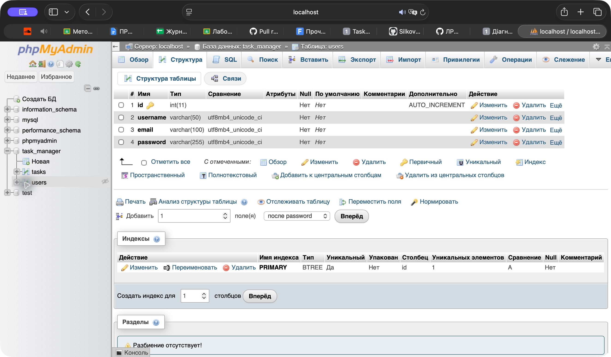
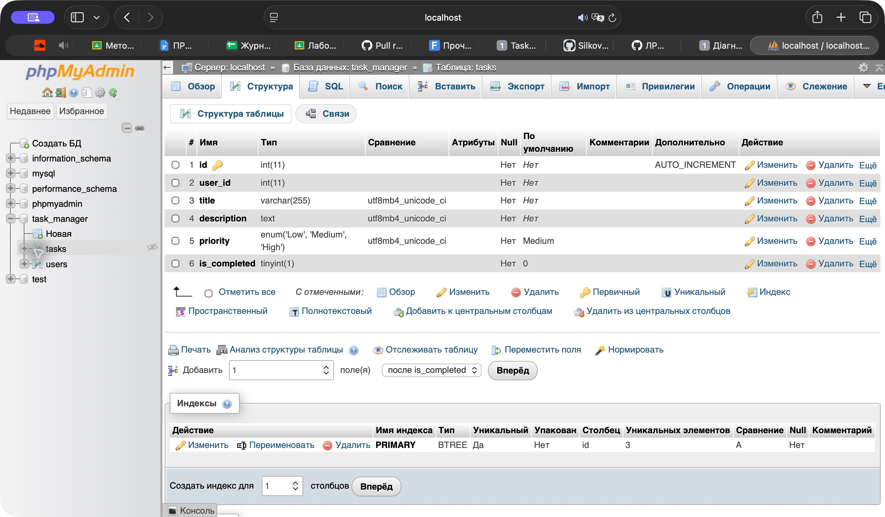
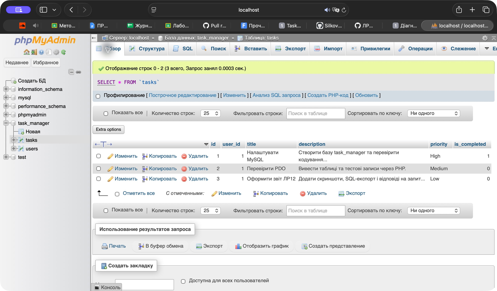
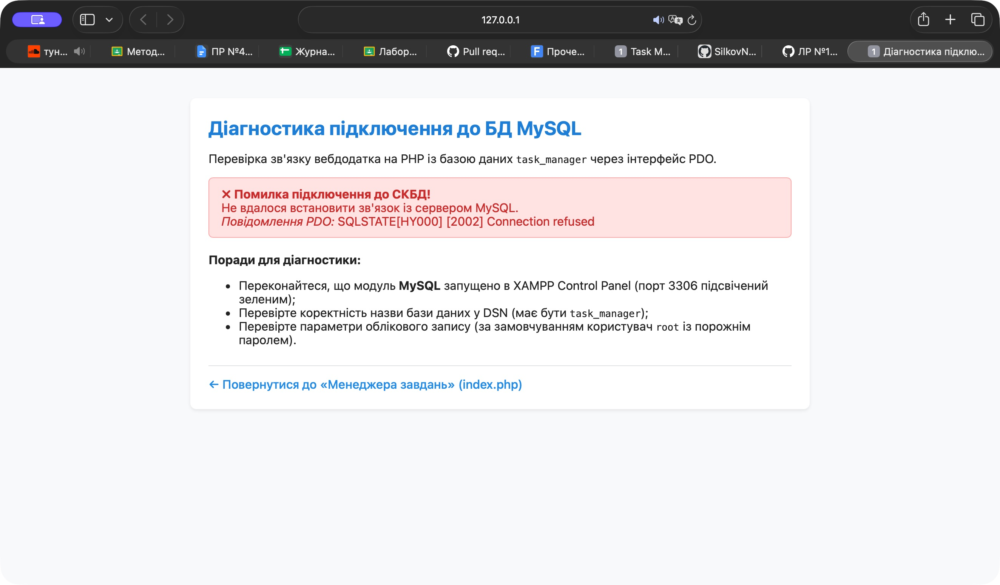
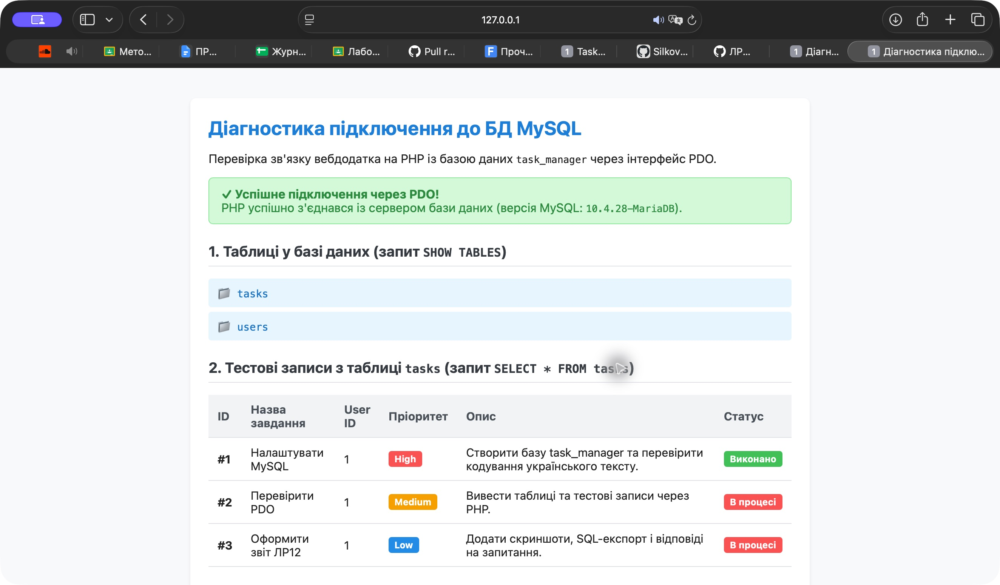

# Лабораторна робота №12

**Студент:** Сілков Нікіта  
**Група:** КН25  
**Дата:** 02.11.2026  
**Тема:** Налаштування СКБД MySQL, створення бази даних і підключення PHP через PDO.

## Мета

Навчитися працювати з MySQL/MariaDB через phpMyAdmin, створювати таблиці й первинні ключі, підключати PHP до бази через PDO та обробляти помилки з’єднання.

## Виконання

1. Запущено Apache і MySQL у складі XAMPP. Середовище: PHP 8.2.4, MariaDB 10.4.28, phpMyAdmin 5.2.1.
2. Через редактор SQL у вебінтерфейсі phpMyAdmin створено базу `task_manager` із `utf8mb4_unicode_ci` та дві таблиці InnoDB.
3. `users`: `id INT PRIMARY KEY AUTO_INCREMENT`, `username VARCHAR(50)`, `email VARCHAR(100)`, `password VARCHAR(255)`.
4. `tasks`: `id INT PRIMARY KEY AUTO_INCREMENT`, `user_id INT`, `title VARCHAR(255)`, `description TEXT`, `priority ENUM('Low','Medium','High')`, `is_completed TINYINT(1) DEFAULT 0`. На цьому етапі user_id є ідентифікатором власника; зовнішній ключ умовою не вимагається і не доданий.
5. Додано навчального користувача `admin`, email `admin@example.com`. У password збережено bcrypt-хеш, створений через `password_hash()`, замість відкритого тексту.
6. Додано три завдання з user_id=1: «Налаштувати MySQL» (High, виконано), «Перевірити PDO» (Medium, в процесі), «Оформити звіт ЛР12» (Low, в процесі).
7. До проєкту ЛР11 додано `test_db.php`: PDO, винятки, асоціативне читання, вимкнена емуляція підготовлених запитів, `SHOW TABLES`, `SELECT * FROM tasks ORDER BY id ASC` та екранування виведених значень. У `index.php` додано посилання на діагностику. Основний менеджер продовжує використовувати JSON; заміна репозиторію належить до ЛР13.
8. Експорт виконано саме вкладкою «Експорт» phpMyAdmin, формат SQL, швидкий режим. Завантажений task_manager.sql збережено в репозиторії як `database.sql`.

## Схема та тестові дані

### Структура users



### Структура tasks



### Записи tasks у phpMyAdmin



## Перевірка підключення

До запуску MySQL сторінка повернула оформлене повідомлення `Connection refused`, а не Fatal Error. Після запуску сервера на 3306 вона успішно прочитала таблиці `tasks`, `users` і всі три записи з українським текстом. HTTP-статуси: 503 при недоступній БД, 200 при успіху. Додатково відмову відтворено окремим тестовим PHP-сервером із DB_PORT=1, не зупиняючи робочу службу. Синтаксис змінених PHP-файлів перевірено через php -l.

### Недоступна база



### Успішне підключення



## Запуск та відновлення бази

Запустити Apache/MySQL у XAMPP. У phpMyAdmin створити порожню базу `task_manager` із `utf8mb4_unicode_ci`, обрати її та імпортувати `database.sql`. Швидкий експорт містить таблиці, дані, ключі та AUTO_INCREMENT, але не команду CREATE DATABASE. Імпортувати слід у порожню базу, щоб не дублювати таблиці.

Параметри за замовчуванням: 127.0.0.1:3306, база task_manager, користувач root, порожній пароль для локального XAMPP. Їх можна перевизначити змінними середовища DB_HOST, DB_PORT, DB_NAME, DB_USER, DB_PASSWORD. Реальні паролі не потрібно записувати в репозиторій.

Із кореня репозиторію:

```sh
php -S 127.0.0.1:8112 -t phpsilkov25
```

Відкрити `http://127.0.0.1:8112/test_db.php`. Якщо PHP не доданий у PATH, використати `/Applications/XAMPP/xamppfiles/bin/php`. Діагностика читає навчальні записи без входу; авторизація основного менеджера залишається попередньою. GitHub Pages не виконує PHP і не запускає MySQL — для демонстрації потрібен локальний сервер.

## Відповіді на контрольні запитання

1. **Що таке СКБД, MySQL і phpMyAdmin?** СКБД — програмна система для створення, зберігання, пошуку та зміни даних, керування доступом і транзакціями. MySQL/MariaDB — сервер, який фактично зберігає дані та виконує SQL. phpMyAdmin — вебклієнт, що надсилає цьому серверу запити через графічний інтерфейс; сам він не замінює сервер БД.

2. **Навіщо AUTO_INCREMENT?** Сервер автоматично призначає новому рядку наступний ідентифікатор, якщо ID не задано явно. Це спрощує вставлення та виключає потребу вручну рахувати ID. Послідовність може мати пропуски; її не слід використовувати як кількість записів.

3. **Що таке PRIMARY KEY?** Первинний ключ однозначно ідентифікує рядок, не допускає NULL і дублікатів. Він дозволяє точно оновлювати або видаляти потрібний запис і посилатися на нього з інших таблиць. У цій схемі ключем обох таблиць є id. SQL дозволяє таблиці без первинного ключа, проте для сутностей users/tasks стабільний ключ необхідний для надійної роботи застосунку.

4. **VARCHAR і TEXT.** VARCHAR(n) зберігає рядок змінної довжини з явно заданою максимальною кількістю символів — зручно для логіна, email та назви. TEXT призначений для довших описів; звичайний TEXT має межу 65 535 байтів, тому кількість символів залежить від кодування. Обидва типи текстові, але відрізняються обмеженнями, способами індексування й типовим застосуванням.

5. **Чому password VARCHAR(255)?** Зберігається результат password_hash(), а не відкритий пароль. Хеш містить ідентифікатор алгоритму, параметри та сіль. Довжина може змінюватися при оновленні алгоритму PASSWORD_DEFAULT, тому 255 символів дають запас. Перевірка виконується password_verify(); відновлювати початковий пароль із хешу не потрібно.

6. **Що таке PDO?** Це об’єктний інтерфейс PHP для доступу до різних СКБД через драйвери. Він надає підготовлені запити, параметри, транзакції та обробку винятків. Застарілі mysql_* видалено з PHP 7. PDO із параметризованими запитами дозволяє безпечно передавати значення без ручного склеювання SQL, хоча сама наявність PDO не захищає небезпечний SQL автоматично.

7. **Що таке DSN?** Рядок описує драйвер та параметри джерела даних. Тут використано mysql:host=127.0.0.1;port=3306;dbname=task_manager;charset=utf8mb4. mysql позначає драйвер, host/port — сервер, dbname — базу, charset — кодування з’єднання. Порт може мати стандартне значення; замість мережевого host також можна використати unix_socket. Логін і пароль передаються окремими параметрами конструктора PDO.

8. **Навіщо try/catch(PDOException)?** Сервер може бути вимкнений, адреса або облікові дані — неправильними, база — відсутньою. Перехоплення дозволяє показати контрольоване повідомлення, замість неперехопленого винятку й аварійного завершення. ERRMODE_EXCEPTION так само охоплює помилки SQL. У навчальній локальній діагностиці текст винятку екранується та показується для пошуку причини; у публічному застосунку докладні дані слід записувати в журнал, а користувачу показувати загальне повідомлення.

## Повний код test_db.php

```php
<?php
declare(strict_types=1);

// 1. Параметри підключення до СКБД MySQL (налаштування для XAMPP/MAMP)
$host = getenv('DB_HOST') ?: '127.0.0.1';
$port = getenv('DB_PORT') ?: '3306';
$dbname = getenv('DB_NAME') ?: 'task_manager';
$username = getenv('DB_USER') ?: 'root';
$password = getenv('DB_PASSWORD') ?: ''; // За замовчуванням у XAMPP пароль користувача root порожній
$charset  = 'utf8mb4';

// 2. Формування рядка DSN (Data Source Name)
$dsn = "mysql:host={$host};port={$port};dbname={$dbname};charset={$charset}";

$tables = [];
$tasks = [];
$connectionStatus = false;
$errorMessage = null;
$serverInfo = '';

// 3. Конфігурація критичних атрибутів PDO:
// - ATTR_ERRMODE => викидати PDOException у разі будь-якої помилки SQL
// - ATTR_DEFAULT_FETCH_MODE => повертати асоціативні масиви
// - ATTR_EMULATE_PREPARES => вимикати емуляцію підготовлених виразів
$options = [
    PDO::ATTR_TIMEOUT => 3,
    PDO::ATTR_ERRMODE            => PDO::ERRMODE_EXCEPTION,
    PDO::ATTR_DEFAULT_FETCH_MODE => PDO::FETCH_ASSOC,
    PDO::ATTR_EMULATE_PREPARES   => false,
];

try {
    // Встановлення з'єднання з базою даних
    $pdo = new PDO($dsn, $username, $password, $options);
    $connectionStatus = true;
    $serverInfo = (string)$pdo->getAttribute(PDO::ATTR_SERVER_VERSION);

    // Крок А: Отримання списку таблиць у базі даних за допомогою SHOW TABLES
    $tablesStmt = $pdo->query('SHOW TABLES');
    $tables = $tablesStmt->fetchAll(PDO::FETCH_COLUMN);

    // Крок Б: Отримання тестових записів із таблиці tasks (якщо таблиця вже створена)
    if (in_array('tasks', $tables, true)) {
        $tasksStmt = $pdo->query('SELECT * FROM tasks ORDER BY id ASC');
        $tasks = $tasksStmt->fetchAll();
    }
} catch (PDOException $e) {
    // Перехоплюємо виняток підключення (використовуючи принципи обробки помилок із ЛР №11)
    $connectionStatus = false;
    http_response_code(503);
    $errorMessage = $e->getMessage();
}
?>
<!DOCTYPE html>
<html lang="uk">
<head>
    <meta charset="UTF-8">
    <title>Діагностика підключення до БД (MySQL PDO)</title>
    <style>
        body {
            font-family: -apple-system, BlinkMacSystemFont, "Segoe UI", Roboto, sans-serif;
            max-width: 820px;
            margin: 40px auto;
            padding: 0 20px;
            color: #222;
            background-color: #f8f9fa;
        }
        .card {
            background: #fff;
            padding: 24px;
            border-radius: 8px;
            box-shadow: 0 2px 4px rgba(0,0,0,0.08);
            margin-bottom: 20px;
        }
        h1 { margin-top: 0; font-size: 1.6em; color: #1c7ed6; }
        h2 { font-size: 1.2em; color: #343a40; margin-top: 24px; border-bottom: 1px solid #dee2e6; padding-bottom: 8px; }
        .alert-success {
            background: #d3f9d8;
            border: 1px solid #8ce99a;
            color: #2b8a3e;
            padding: 12px 16px;
            border-radius: 6px;
            margin-bottom: 20px;
        }
        .alert-error {
            background: #ffe3e3;
            border: 1px solid #ffa8a8;
            color: #c92a2a;
            padding: 12px 16px;
            border-radius: 6px;
            margin-bottom: 20px;
        }
        .badge {
            display: inline-block;
            padding: 3px 8px;
            border-radius: 4px;
            font-size: 0.8em;
            font-weight: bold;
        }
        .badge-success { background: #40c057; color: #fff; }
        .badge-danger  { background: #fa5252; color: #fff; }
        .badge-info    { background: #228be6; color: #fff; }
        .badge-warning { background: #f59f00; color: #fff; }
        table {
            width: 100%;
            border-collapse: collapse;
            margin-top: 12px;
        }
        th, td {
            text-align: left;
            padding: 10px 12px;
            border-bottom: 1px solid #dee2e6;
            font-size: 0.95em;
        }
        th { background: #f1f3f5; color: #495057; }
        ul.tables-list { list-style: none; padding: 0; margin: 12px 0; }
        ul.tables-list li {
            padding: 8px 12px;
            background: #e7f5ff;
            color: #1971c2;
            margin-bottom: 6px;
            border-radius: 4px;
            font-family: monospace;
            font-size: 1.05em;
        }
        .nav-links {
            margin-top: 25px;
            padding-top: 15px;
            border-top: 1px solid #dee2e6;
        }
        .nav-links a {
            color: #228be6;
            text-decoration: none;
            font-weight: 500;
        }
        .nav-links a:hover { text-decoration: underline; }
    </style>
</head>
<body>

    <div class="card">
        <h1>Діагностика підключення до БД MySQL</h1>
        <p>Перевірка зв'язку вебдодатка на PHP із базою даних <code><?= htmlspecialchars($dbname) ?></code> через інтерфейс PDO.</p>

        <?php if ($connectionStatus): ?>
            <div class="alert-success">
                <strong>✓ Успішне підключення через PDO!</strong><br>
                PHP успішно з'єднався із сервером бази даних (версія MySQL: <code><?= htmlspecialchars($serverInfo) ?></code>).
            </div>

            <h2>1. Таблиці у базі даних (запит <code>SHOW TABLES</code>)</h2>
            <?php if (!empty($tables)): ?>
                <ul class="tables-list">
                    <?php foreach ($tables as $table): ?>
                        <li>📁 <?= htmlspecialchars($table) ?></li>
                    <?php endforeach; ?>
                </ul>
            <?php else: ?>
                <p>У базі даних немає створених таблиць. Перевірте виконання Кроків 3 та 4.</p>
            <?php endif; ?>

            <h2>2. Тестові записи з таблиці <code>tasks</code> (запит <code>SELECT * FROM tasks</code>)</h2>
            <?php if (!empty($tasks)): ?>
                <table>
                    <thead>
                        <tr>
                            <th>ID</th>
                            <th>Назва завдання</th>
                            <th>User ID</th>
                            <th>Пріоритет</th>
                            <th>Опис</th>
                            <th>Статус</th>
                        </tr>
                    </thead>
                    <tbody>
                        <?php foreach ($tasks as $task): ?>
                            <tr>
                                <td><strong>#<?= htmlspecialchars((string)($task['id'] ?? '')) ?></strong></td>
                                <td><?= htmlspecialchars((string)($task['title'] ?? '')) ?></td>
                                <td><?= htmlspecialchars((string)($task['user_id'] ?? '')) ?></td>
                                <td>
                                    <?php
                                    $p = $task['priority'] ?? 'Medium';
                                    $badgeClass = match ($p) {
                                        'High' => 'badge-danger',
                                        'Low' => 'badge-info',
                                        default => 'badge-warning',
                                    };
                                    ?>
                                    <span class="badge <?= $badgeClass ?>"><?= htmlspecialchars((string)$p) ?></span>
                                </td>
                                <td><?= htmlspecialchars((string)($task['description'] ?? '—')) ?></td>
                                <td>
                                    <?php if (!empty($task['is_completed'])): ?>
                                        <span class="badge badge-success">Виконано</span>
                                    <?php else: ?>
                                        <span class="badge badge-danger">В процесі</span>
                                    <?php endif; ?>
                                </td>
                            </tr>
                        <?php endforeach; ?>
                    </tbody>
                </table>
            <?php else: ?>
                <p>У таблиці <code>tasks</code> поки немає записів. Додайте 2–3 тестові завдання через вкладку «Вставити» (Insert) у phpMyAdmin.</p>
            <?php endif; ?>

        <?php else: ?>
            <div class="alert-error">
                <strong>✗ Помилка підключення до СКБД!</strong><br>
                Не вдалося встановити зв'язок із сервером MySQL.<br>
                <em>Повідомлення PDO:</em> <?= htmlspecialchars($errorMessage ?? 'Невідома помилка') ?>
            </div>

            <p><strong>Поради для діагностики:</strong></p>
            <ul>
                <li>Переконайтеся, що модуль <strong>MySQL</strong> запущено в XAMPP Control Panel (порт 3306 підсвічений зеленим);</li>
                <li>Перевірте коректність назви бази даних у DSN (має бути <code>task_manager</code>);</li>
                <li>Перевірте параметри облікового запису (за замовчуванням користувач <code>root</code> із порожнім паролем).</li>
            </ul>
        <?php endif; ?>

        <div class="nav-links">
            <a href="index.php">← Повернутися до «Менеджера завдань» (index.php)</a>
        </div>
    </div>

</body>
</html>
```

## Висновок

Створено початкову реляційну схему менеджера завдань, додано навчальні записи й перевірено їх читання через PDO. Помилка підключення обробляється контрольовано. SQL-експорт дозволяє відтворити таблиці та тестові дані на іншому локальному сервері.

## Матеріали

- [Умова ЛР12](https://surkovkostiantyn.github.io/nmk/programming/lab_12.html)
- [SQL-експорт](database.sql)
- [Діагностичний скрипт](test_db.php)
- [Код проєкту](https://github.com/nikitauroboros-cpu/SilkovNikitaKNK25/tree/main/phpsilkov25)
