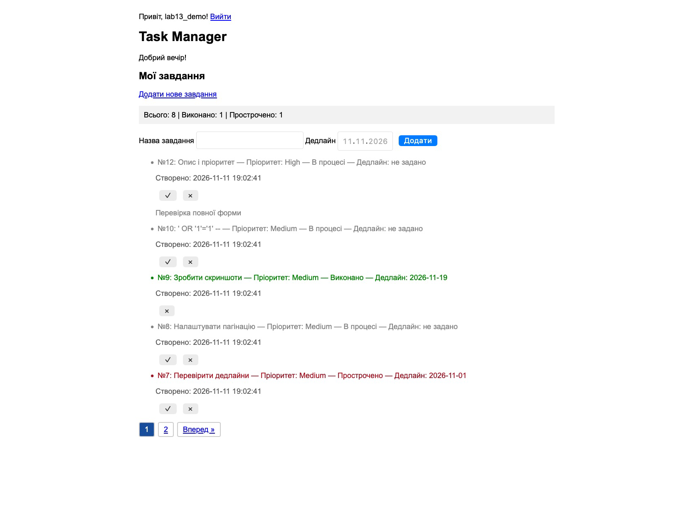
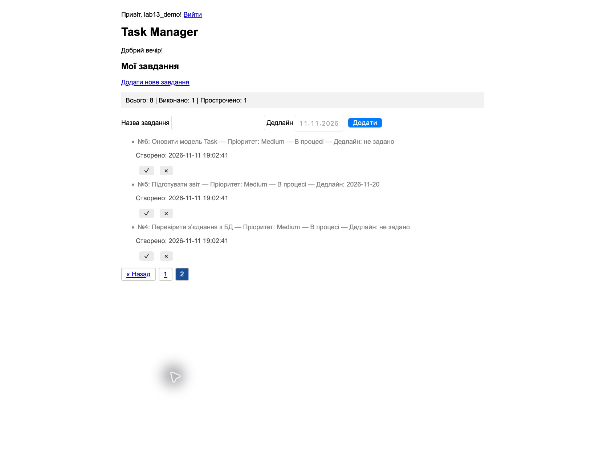
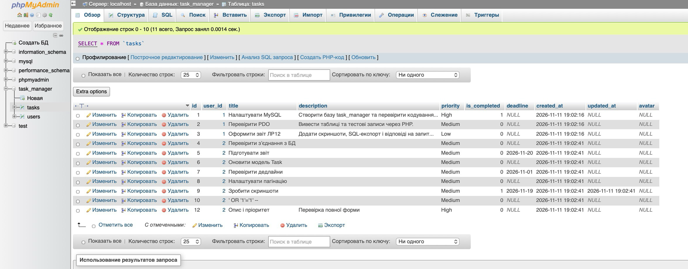

# Лабораторна робота №13

**Виконав:** Сілков Нікіта, КН-25

**Тема:** патерн Repository та CRUD-операції в менеджері завдань.

Менеджер завдань з ЛР №11 підключено до бази `task_manager` з ЛР №12 через PDO. Фабрика [Database](Database.php) налаштовує винятки, асоціативну вибірку та нативні підготовлені вирази. Після входу ідентифікатор користувача зберігається в сесії й використовується для вибірки, підрахунку та зміни завдань. Файл [міграції](lab13-migration.sql) додає дедлайн, часові мітки, поле зображення та зовнішній ключ.

## Запуск

1. Запустити Apache та MariaDB у XAMPP. Для нової бази створити `task_manager` та імпортувати [database.sql](database.sql).
2. У базу `task_manager` імпортувати [lab13-migration.sql](lab13-migration.sql). Для цієї міграції використано синтаксис MariaDB з XAMPP.
3. Розмістити файли у папці `htdocs/lab13` і відкрити `http://localhost/lab13/index.php`. Навчальний вхід для локального запуску — `lab13_demo` з паролем `Lab13-demo!`. Для завантаження зображень каталог `uploads` має бути доступним для запису Apache.
4. Додати понад п’ять завдань, щоб перевірити навігацію між сторінками.

## Перевірка в XAMPP

- Через форму додано вісім завдань із дедлайнами та без них. Розширену форму перевірено окремо, вона зберегла опис і пріоритет.
- На першій сторінці відображено п’ять завдань, на другій — три. На обох сторінках лічильник охоплює всі завдання поточного користувача.
- Рядок `' OR '1'='1' --` збережено як назву завдання №10. У phpMyAdmin видно значення поля `title`.
- Завдання №9 позначено виконаним. У таблиці збережено `is_completed = 1` та заповнено `updated_at`. Тестове завдання №11 видалено.
- Спроба видалити завдання №1 іншого користувача повернула HTTP 404. Запис залишився в таблиці.

### Сторінка 1



### Сторінка 2



### Таблиця tasks у phpMyAdmin



## Фрагменти TaskRepository.php

### `add()`

```php
public function add(string $title, int $userId, ?string $deadline = null,
    string $description = '', string $priority = 'Medium', ?string $avatar = null): Task
{
    $task = new Task(0, $title, false, $deadline, $description, $priority,
        avatar: $avatar, userId: $userId);
    $stmt = $this->pdo->prepare(
        'INSERT INTO tasks (user_id, title, deadline, description, priority, avatar, created_at)
         VALUES (:user_id, :title, :deadline, :description, :priority, :avatar, :created_at)'
    );
    $stmt->execute([
        'user_id' => $task->userId,
        'title' => $task->getTitle(),
        'deadline' => $task->getDeadline(),
        'description' => $task->getDescription(),
        'priority' => $task->getPriority(),
        'avatar' => $task->getAvatar(),
        'created_at' => $task->getCreatedAt(),
    ]);

    $row = $task->toArray();
    $row['id'] = (int) $this->pdo->lastInsertId();
    return Task::fromArray($row);
}
```

### `findAllByUser()`

```php
public function findAllByUser(int $userId, int $page = 1, int $perPage = 5): array
{
    $stmt = $this->pdo->prepare(
        'SELECT * FROM tasks WHERE user_id = :user_id ORDER BY id DESC LIMIT :limit OFFSET :offset'
    );
    $stmt->bindValue(':user_id', $userId, PDO::PARAM_INT);
    $stmt->bindValue(':limit', $perPage, PDO::PARAM_INT);
    $stmt->bindValue(':offset', ($page - 1) * $perPage, PDO::PARAM_INT);
    $stmt->execute();

    return array_map([Task::class, 'fromArray'], $stmt->fetchAll());
}
```

### `complete()`

```php
public function complete(int $id, int $userId): bool
{
    $stmt = $this->pdo->prepare(
        'UPDATE tasks SET is_completed = 1, updated_at = :updated_at
         WHERE id = :id AND user_id = :user_id'
    );
    $stmt->execute(['updated_at' => date('Y-m-d H:i:s'), 'id' => $id, 'user_id' => $userId]);
    if ($stmt->rowCount() === 0) {
        throw new TaskNotFoundException($id);
    }

    return true;
}
```

### `delete()`

```php
public function delete(int $id, int $userId): bool
{
    $stmt = $this->pdo->prepare('DELETE FROM tasks WHERE id = :id AND user_id = :user_id');
    $stmt->execute(['id' => $id, 'user_id' => $userId]);
    if ($stmt->rowCount() === 0) {
        throw new TaskNotFoundException($id);
    }

    return true;
}
```

## Контрольні запитання

1. **Що таке PDO?** PHP Data Objects — розширення PHP зі спільним об’єктним інтерфейсом для різних драйверів СУБД. Воно підтримує підготовлені вирази, транзакції та обробку помилок винятками. Старе розширення `mysql_*` вилучено з PHP 7. Процедурний `mysqli` теж підтримує підготовлені вирази, але орієнтований на MySQL-сумісні СУБД.
2. **Як підготовлені вирази захищають від SQL-ін’єкцій?** SQL-шаблон містить плейсхолдери, а введені значення передаються окремо. Сервер використовує їх як дані. Під час конкатенації лапки й оператори з введеного тексту можуть змінити структуру SQL. Для динамічних ідентифікаторів потрібен список дозволених значень, оскільки плейсхолдери призначені для значень.
3. **Навіщо `PDO::PARAM_INT` для `LIMIT` та `OFFSET`?** Ці параметри задають цілі числа. `bindValue()` явно вказує цей тип, тоді як значення з масиву `execute()` обробляються як `PDO::PARAM_STR`. Явне прив’язування усуває залежність від перетворення рядків драйвером.
4. **Для чого `lastInsertId()`?** Метод повертає ідентифікатор, згенерований під час вставки, як рядок або `false` при помилці. Його викликають одразу після успішного `INSERT` у тому самому з’єднанні, перед іншою вставкою. У репозиторії результат перетворюється на `int`.
5. **Як працює пагінація?** `COUNT(*)` рахує завдання користувача. `ORDER BY id DESC` задає стабільний порядок, `LIMIT` обмежує кількість рядків, а `OFFSET` пропускає попередні записи. Формула `(page - 1) * perPage` дає зміщення 0 для першої сторінки та 5 для другої при розмірі сторінки 5.

[Методичні вказівки](https://surkovkostiantyn.github.io/nmk/programming/lab_13.html)
