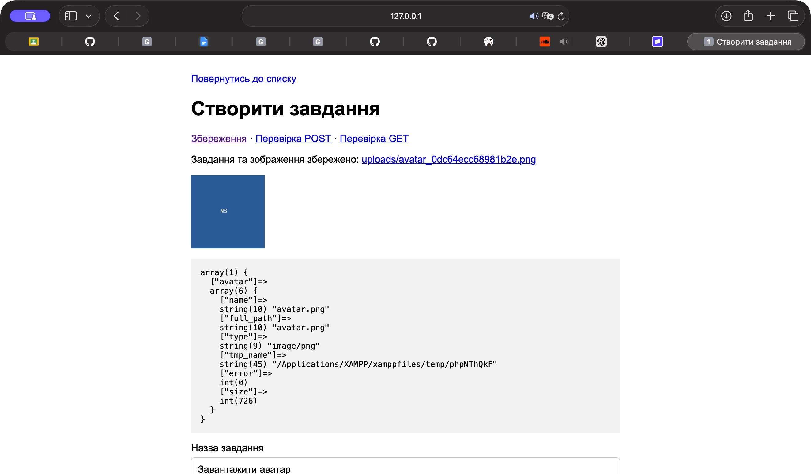
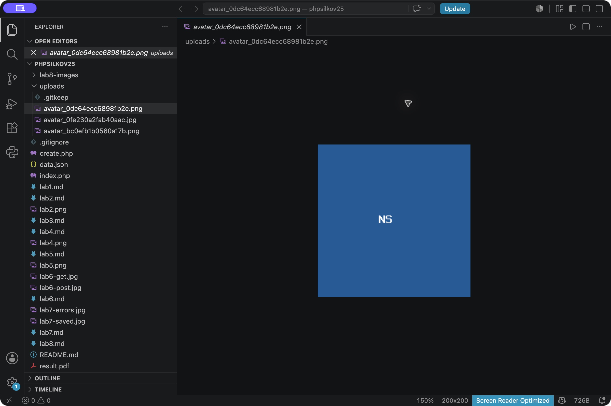

# Лабораторна робота №8

**Студент:** Сілков Нікіта  
**Тема:** Завантаження файлів (робота з файлами).

## Мета

Додати до форми завдання завантаження зображення, перевірити отриманий файл і зберегти його в папці проєкту.

## Хід роботи

У `create.php` форма надсилає POST із `enctype="multipart/form-data"`. Додано поле:

```html
<input type="file" id="avatar" name="avatar" accept="image/png,image/jpeg">
```

Зображення необов’язкове: попередня можливість створити текстове завдання залишається. Якщо файл вибрано, сервер перевіряє помилку завантаження, розмір до 2 МБ, розширення JPG/JPEG/PNG та фактичний тип зображення. Самого `accept` у браузері недостатньо. Помилки потрапляють до спільного масиву `$errors` і виводяться над формою через `htmlspecialchars()`.

### Код обробника upload.php

```php
<?php
$avatarPath = null;
$avatar = $_FILES['avatar'] ?? null;
if ($avatar !== null) {
    if (!is_array($avatar) || !is_int($avatar['error'] ?? null)) {
        $errors[] = 'Некоректний формат завантаження.';
    } elseif ($avatar['error'] === UPLOAD_ERR_NO_FILE) {
        $avatar = null;
    } elseif ($avatar['error'] !== UPLOAD_ERR_OK) {
        $errors[] = in_array($avatar['error'], [UPLOAD_ERR_INI_SIZE, UPLOAD_ERR_FORM_SIZE], true)
            ? 'Файл завеликий! Максимум 2 МБ.'
            : 'Помилка завантаження файлу. Спробуйте ще раз.';
    } elseif (!is_string($avatar['name'] ?? null) || !is_string($avatar['tmp_name'] ?? null)
        || !is_int($avatar['size'] ?? null) || !is_uploaded_file($avatar['tmp_name'])) {
        $errors[] = 'Некоректний файл.';
    } else {
        $extension = strtolower(pathinfo($avatar['name'], PATHINFO_EXTENSION));
        $mime = (new finfo(FILEINFO_MIME_TYPE))->file($avatar['tmp_name']);
        $types = ['jpg' => 'image/jpeg', 'jpeg' => 'image/jpeg', 'png' => 'image/png'];
        if ($avatar['size'] > 2 * 1024 * 1024) {
            $errors[] = 'Файл завеликий! Максимум 2 МБ.';
        }
        if (!isset($types[$extension]) || $types[$extension] !== $mime
            || @getimagesize($avatar['tmp_name']) === false) {
            $errors[] = 'Дозволено лише справжні зображення JPG або PNG.';
        }
        if (empty($errors) && !$isDemo) {
            $directory = __DIR__ . '/uploads';
            if (!is_dir($directory) && !mkdir($directory, 0755, true) && !is_dir($directory)) {
                $errors[] = 'Не вдалося створити папку uploads.';
            } else {
                $avatarPath = 'uploads/avatar_' . bin2hex(random_bytes(8)) . '.' . $extension;
                if (!move_uploaded_file($avatar['tmp_name'], __DIR__ . '/' . $avatarPath)) {
                    $errors[] = 'Не вдалося зберегти зображення.';
                    $avatarPath = null;
                }
            }
        }
    }
}
```

Обробник підключається після перевірки текстових полів. Для перегляду отриманих даних у `create.php` використано:

```php
if ($_SERVER['REQUEST_METHOD'] === 'POST') {
    require __DIR__ . '/upload.php';
    ob_start();
    var_dump($_FILES);
    $dump = ob_get_clean();
}
```

У HTML результат виводиться як `<pre><?= escape($dump) ?></pre>`. Буфер потрібний, щоб до завершення обробки не надсилати HTML. У звичайному режимі правильна форма з файлом зберігає завдання в JSON і показує посилання, зображення та масив. У режимі «Перевірка POST» відображаються дані без збереження. GET залишено для попередньої лабораторної; через нього файли не завантажуються.

### Перевірка у браузері

Через форму вибрано `avatar.png` — зображення з ініціалами NS. Після надсилання показано успішне збереження та `error = 0`.



У PHP 8.2 додатково присутній ключ `full_path`, тому на скриншоті шість ключів. Усі п’ять із завдання (`name`, `type`, `tmp_name`, `error`, `size`) також є. Значення `tmp_name` показує тимчасовий шлях, з якого файл уже переміщено.

### Файл у проєкті



Файлу надається випадкова назва, щоб не перезаписати інше зображення з таким самим початковим ім’ям. Папка створюється за потреби. Шлях додається до запису завдання в `data.json`. Якщо запис завдання не вдався, щойно завантажене зображення видаляється.

### Результати перевірок

- PNG та JPEG успішно зберігаються.
- Файл понад 2 МБ відхиляється.
- Текстовий файл із розширенням PNG відхиляється.
- При порожній назві завдання файл не зберігається.
- Демонстраційний POST не змінює JSON і папку uploads.
- Завдання без картинки можна створити, як у попередній роботі.

До `.gitignore` додано:

```gitignore
uploads/*
!uploads/.gitkeep
```

На GitHub зберігається порожня папка через `.gitkeep`, код і скриншоти звіту. Самі завантаження залишаються локально.

## Відповіді на контрольні запитання

1. **Що таке multipart/form-data?** Це спосіб кодування тіла HTTP-запиту, у якому поля і файли передаються окремими частинами. Для форми з файлом потрібні POST та цей `enctype`, інакше байти файлу не потраплять до `$_FILES`.
2. **Які ключі містить $_FILES?** `name` — початкове ім’я, `type` — тип, повідомлений браузером, `tmp_name` — тимчасовий шлях на сервері, `error` — код помилки, `size` — розмір у байтах. У сучасному PHP також є `full_path`. Значенням браузера не можна повністю довіряти, тому тип перевіряється на сервері.
3. **Навіщо тимчасова папка?** PHP приймає файл до тимчасового сховища, а програма вирішує, чи дозволено його зберегти. Якщо не перемістити файл, PHP прибере його після завершення запиту.
4. **Що робить move_uploaded_file()?** Перевіряє, що джерело є файлом, завантаженим через HTTP POST, і переміщує його у вказане місце. `copy()` лише копіює файл та не виконує цієї перевірки. Перевірки типу, розміру й кінцевого імені все одно потрібні окремо.
5. **Чим небезпечне завантаження будь-яких файлів?** Можна отримати виконуваний скрипт, перезаписати наявний файл або заповнити диск великими файлами. Тому дозволяються лише потрібні типи, встановлюється обмеження розміру та генеруються власні імена.

## Висновок

Форма приймає зображення через POST, перевіряє їх і переміщує до uploads. Отримані параметри перевірено через var_dump, а збережений файл відкрито в редакторі.

[Умова](https://surkovkostiantyn.github.io/nmk/programming/lab_08.html) · [Приклад викладача](https://github.com/SurkovKostiantyn/kn25ipz25/tree/main/php_lab_8)
