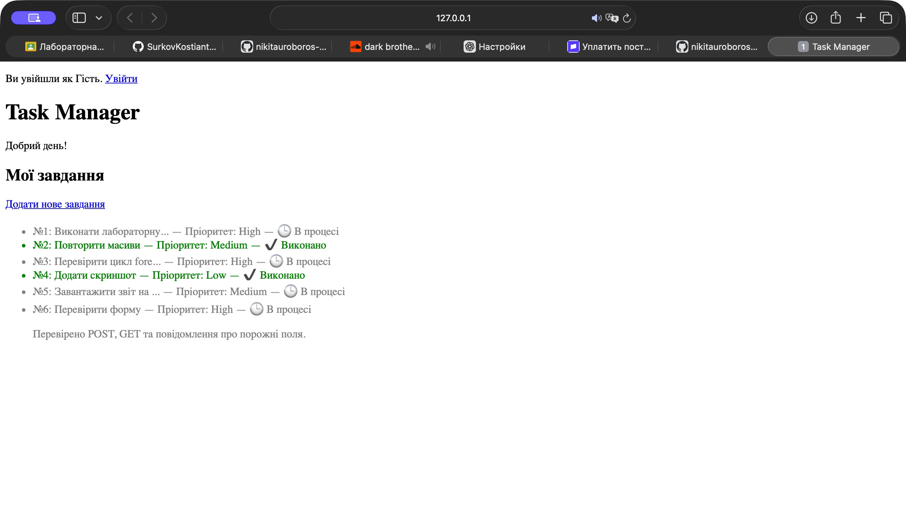
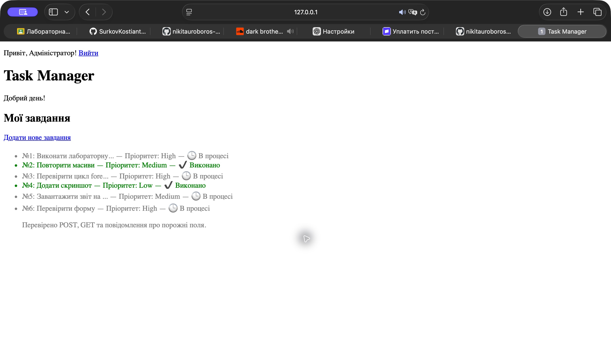

# Лабораторна робота №9

**Студент:** Сілков Нікіта  
**Тема:** Сторінка логіну. Сесії.

## Мета

Створити простий вхід до Task Manager, зберегти стан користувача в сесії та закрити створення завдань для гостей.

## Хід роботи

Створено `login.php` із полями `username`, `password` та кнопкою «Увійти». Форма надсилає POST сама на себе. Для навчальної перевірки використано логін **admin** і пароль **12345**, прописані в коді за умовою лабораторної.

### Авторизація в login.php

```php
<?php
session_start();
$error = '';
$username = '';
if ($_SERVER['REQUEST_METHOD'] === 'POST') {
    $username = is_string($_POST['username'] ?? null) ? $_POST['username'] : '';
    $password = is_string($_POST['password'] ?? null) ? $_POST['password'] : '';
    if ($username === 'admin' && $password === '12345') {
        session_regenerate_id(true);
        $_SESSION['is_logged_in'] = true;
        $_SESSION['user_name'] = 'Адміністратор';
        header('Location: index.php', true, 303);
        exit;
    }
    $error = 'Невірний логін або пароль!';
}
?>
```

Після правильного входу оновлюється ідентифікатор сесії, записуються `is_logged_in` та `user_name`. Сервер повертає перенаправлення 303 на головну. Неправильні дані дають повідомлення «Невірний логін або пароль!». Пароль назад у форму не виводиться.

### Захист create.php

```php
<?php
session_start();
if (($_SESSION['is_logged_in'] ?? false) !== true) {
    header('Location: login.php');
    exit;
}
?>
```

Перевірка виконується до HTML, обробки полів і завантаження зображення з ЛР №8. Вона працює для прямого GET і POST. Сам `upload.php` використовується як підключений обробник; його прямий виклик повертає 404.

### Головна сторінка

На початку `index.php` викликається `session_start()`. Гість бачить «Ви увійшли як Гість» та посилання на вхід. Після авторизації показуються «Привіт, Адміністратор!» і «Вийти». Ім’я виводиться через `htmlspecialchars()`.





### Вихід

`logout.php` очищує `$_SESSION`, прибирає cookie сесії, викликає `session_destroy()` і повертає на головну. Після виходу `create.php` знову недоступна без входу.

## Перевірка

1. Відкрити головну без входу: показано стан гостя.
2. Відкрити `create.php` без авторизації: перехід на `login.php`.
3. Надіслати неправильний пароль: повідомлення про помилку, доступ залишається закритим.
4. Увійти як `admin` / `12345`: головна вітає адміністратора.
5. Перейти на `create.php` і назад: сесія зберігає стан входу.
6. Натиснути «Вийти»: знову показано гостя, форма створення захищена.

Додатково перевірено прямий POST від гостя, зміну ідентифікатора після входу та блокування прямого виклику `upload.php`.

## Відповіді на контрольні запитання

1. **Що означає stateless?** Кожен HTTP-запит обробляється окремо. Сам протокол не зберігає інформацію про попередній вхід. Для зв’язування запитів програма використовує, наприклад, cookie з ідентифікатором сесії.
2. **Різниця між cookie і сесією.** Cookie зберігається в браузері та надсилається серверу з відповідними запитами. Дані `$_SESSION` зберігаються на сервері; у стандартній конфігурації PHP це файли. Браузер зазвичай тримає лише ідентифікатор сесії.
3. **Що таке PHPSESSID?** Це стандартна назва cookie з ідентифікатором PHP-сесії. За цим ідентифікатором сервер знаходить дані користувача. Він не містить сам пароль або весь масив `$_SESSION`.
4. **Чому session_start() викликають до HTML?** Для початку сесії PHP може надсилати HTTP-заголовки, зокрема cookie. Після фактичного надсилання HTML заголовки змінити вже не можна, і виникає попередження `headers already sent`. Буферизація іноді приховує проблему, але правильне місце виклику — перед виведенням.
5. **Для чого Location та exit?** `header('Location: ...')` повідомляє браузеру адресу перенаправлення. Сам PHP після цієї команди не зупиняється. `exit` завершує виконання, щоб гість не отримав приватний HTML і щоб не виконувалася подальша обробка.

## Висновок

Додано навчальну авторизацію через сесії. Стан входу зберігається між сторінками, а створювати завдання можуть лише авторизовані користувачі.

[Код проєкту](https://github.com/nikitauroboros-cpu/SilkovNikitaKNK25/tree/main/phpsilkov25) · [Умова](https://surkovkostiantyn.github.io/nmk/programming/lab_09.html) · [Приклад викладача](https://github.com/SurkovKostiantyn/kn25ipz25/blob/main/php_lec_9/readme.md)
